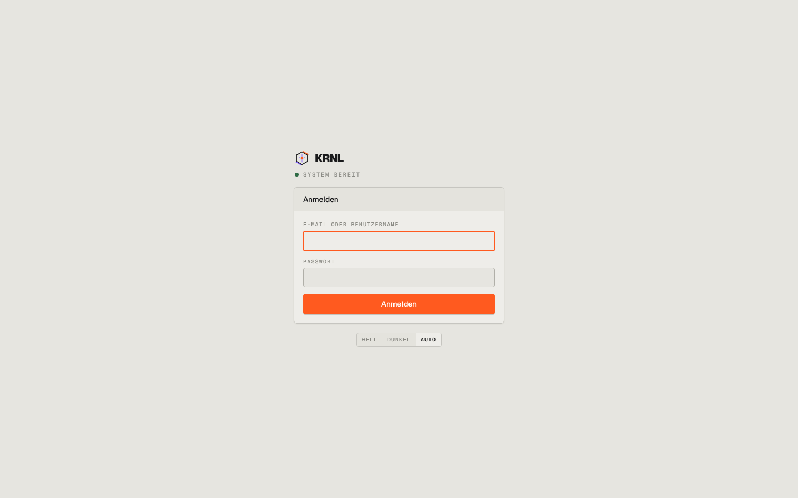

# 000-login — Login

- **Bereich:** Anmeldung & öffentliche Seiten
- **Route:** `/login`
- **Note:** 4 / 5
- **Zweck:** Anmeldung mit E-Mail/Benutzername und Passwort, Theme-Umschalter.
- **Messwerte:** HTTP 200 · Ladezeit 562 ms · Seitenhöhe 900 px · horizontaler Überlauf nein · Texte < 11 px: 5

## Was gut ist

- Sehr ruhig, klare Hierarchie, Fokus liegt sofort im ersten Feld (orangefarbener Fokusrahmen).
- Statusleuchte „System bereit“ gibt Vertrauen vor der Anmeldung.

## Befunde

| Schwere | Kategorie | Befund | Vorschlag |
|---|---|---|---|
| **mittel** | Funktion | Kein „Passwort vergessen“, kein Hinweis, wie man an ein Konto kommt; kein Sichtbar-Schalter fürs Passwort. | Link „Passwort vergessen? Admin fragen“ bzw. Reset-Flow; Auge-Symbol im Passwortfeld. |
| **niedrig** | Layout | Die Karte sitzt oberhalb der optischen Mitte, darunter bleibt rund 40 % leere Fläche; auf 1440×900 wirkt die Seite unvollständig. | Karte vertikal zentrieren oder links Marke/Claim, rechts Formular (Split-Layout wie /start). |
| **niedrig** | Konsistenz | Karten-Titel „Anmelden“ und Knopf „Anmelden“ doppeln sich. | Kartentitel weglassen oder als „Willkommen zurück“ formulieren. |
| **niedrig** | Typografie | Feldlabels in Mono-Versalien mit großem Buchstabenabstand sind klein (≈10 px) und grau — schwer lesbar. | Labels 12 px, Kontrast auf --text-2, Versalien nur für Abschnittsköpfe. |

[← zur Übersicht](../README.md)
