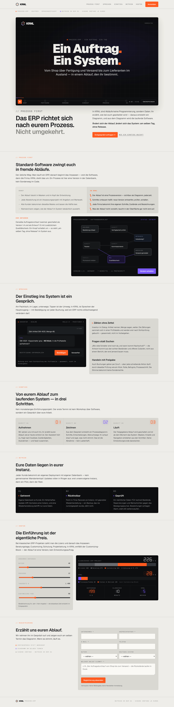

# 001-start — Start (Weiche)

- **Bereich:** Anmeldung & öffentliche Seiten
- **Route:** `/start`
- **Note:** 4 / 5
- **Zweck:** Öffentliche Produktseite/Weiche: Trailer, Prozess-First-Argument, Sprechen, Einstieg, Betrieb, Kosten-Rechner, Registrierung.
- **Messwerte:** HTTP 200 · Ladezeit 744 ms · Seitenhöhe 5841 px · horizontaler Überlauf nein · Texte < 11 px: 23

## Was gut ist

- Starke, eigenständige Gestaltung (dunkle Display-Flächen, Siebensegment-Ziffern) — wiedererkennbar.
- Interaktiver Kostenrechner macht den Nutzen greifbar.
- Gute Abschnittsdramaturgie: Problem → Lösung → Beweis → Kosten → Registrierung.

## Befunde

| Schwere | Kategorie | Befund | Vorschlag |
|---|---|---|---|
| **mittel** | Texte | Die Seite verspricht „Sprachgesteuert“ und „Sprechen ist der Hauptzugang“ — in der Instanz ist „Sprechen“ nur mit OpenAI-Schlüssel sichtbar; der Erstnutzer findet es im Menü nicht. | Versprechen und Produktzustand angleichen oder Sprechen als optionales Modul kennzeichnen. |
| **niedrig** | Typografie | Abschnittsmarker „// PROZESS FIRST“ in Orange-Mono sind sehr klein; im zweiten Abschnitt wiederholt sich derselbe Marker direkt unter dem ersten (Ende Kachel 1/Anfang Kachel 2). | Marker eine Stufe größer; doppelten Marker entfernen. |
| **niedrig** | Layout | Registrierungsformular nutzt native Selects (Nutzer, Heutiges System), die optisch aus dem Stil fallen. | Gestaltete Auswahlboxen wie im internen Teil. |
| **niedrig** | Barrierefreiheit | Siebensegment-Ziffern mit „Geister-Segmenten“ in sehr niedrigem Kontrast; Zahlen sind für Screenreader nur als Grafik erkennbar, falls nicht als Text hinterlegt. | Wert zusätzlich als echten Text (visuell versteckt) ausgeben. |

[← zur Übersicht](../README.md)
