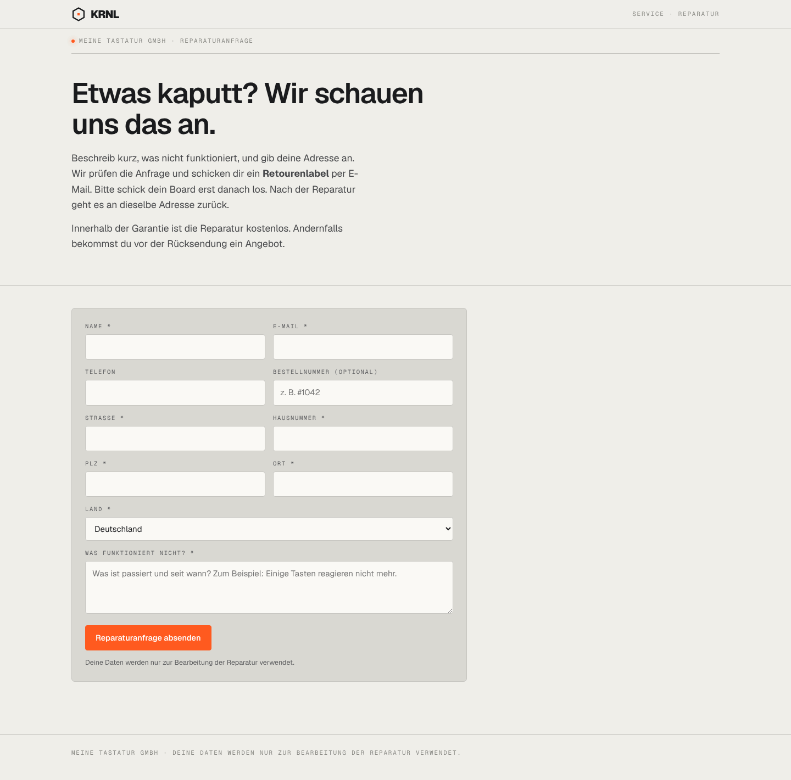

# 002-service-reparatur — Öffentliche Reparaturanfrage

- **Bereich:** Anmeldung & öffentliche Seiten
- **Route:** `/service/reparatur`
- **Note:** 4 / 5
- **Zweck:** Öffentliches Reparaturformular (Fallback außerhalb des Shops).
- **Messwerte:** HTTP 200 · Ladezeit 650 ms · Seitenhöhe 1421 px · horizontaler Überlauf nein · Texte < 11 px: 10

## Was gut ist

- Kurze, freundliche Erklärung inkl. Ablauf (Label → Board schicken → zurück).
- Klare Pflichtfeldmarkierung, sinnvolle Zweispaltigkeit.

## Befunde

| Schwere | Kategorie | Befund | Vorschlag |
|---|---|---|---|
| **niedrig** | Layout | Formular nimmt nur 60 % der Breite, rechte Spalte bleibt leer. | Rechts Ablauf-Schritte (1 Anfrage, 2 Label, 3 Reparatur, 4 Rückversand) als Orientierung. |
| **niedrig** | Konsistenz | Datenschutzsatz steht zweimal (unter dem Knopf und im Fuß). | Einmal, im Fuß oder am Knopf. |
| **niedrig** | Funktion | Kein Hinweis, dass es auch ein Retourenportal gibt (Rücksendung statt Reparatur). | Link „Du willst etwas zurückgeben? → Rücksendung“. |

[← zur Übersicht](../README.md)
