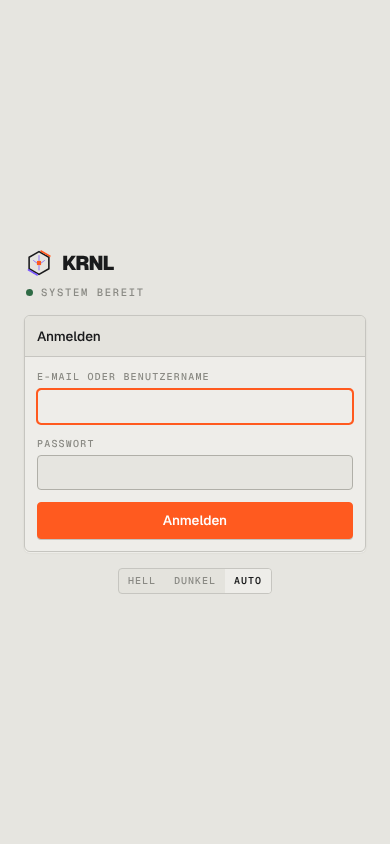

# 003-login-mobil — Login mobil

- **Bereich:** Anmeldung & öffentliche Seiten
- **Route:** `/login`
- **Note:** 4 / 5
- **Zweck:** Login auf dem Telefon (Lager, Packtisch).
- **Messwerte:** HTTP 200 · Ladezeit 562 ms · Seitenhöhe 844 px · horizontaler Überlauf nein · Texte < 11 px: 5

## Was gut ist

- Formular nutzt volle Breite, große Touch-Ziele.

## Befunde

| Schwere | Kategorie | Befund | Vorschlag |
|---|---|---|---|
| **niedrig** | Mobil | Formular sitzt im oberen Drittel mit viel Leerraum unten; Tastatur verdeckt beim Tippen den Knopf nicht, aber die Komposition wirkt zufällig. | Auf Mobil oben beginnen (Marke kleiner), Knopf sticky am unteren Rand. |

[← zur Übersicht](../README.md)
