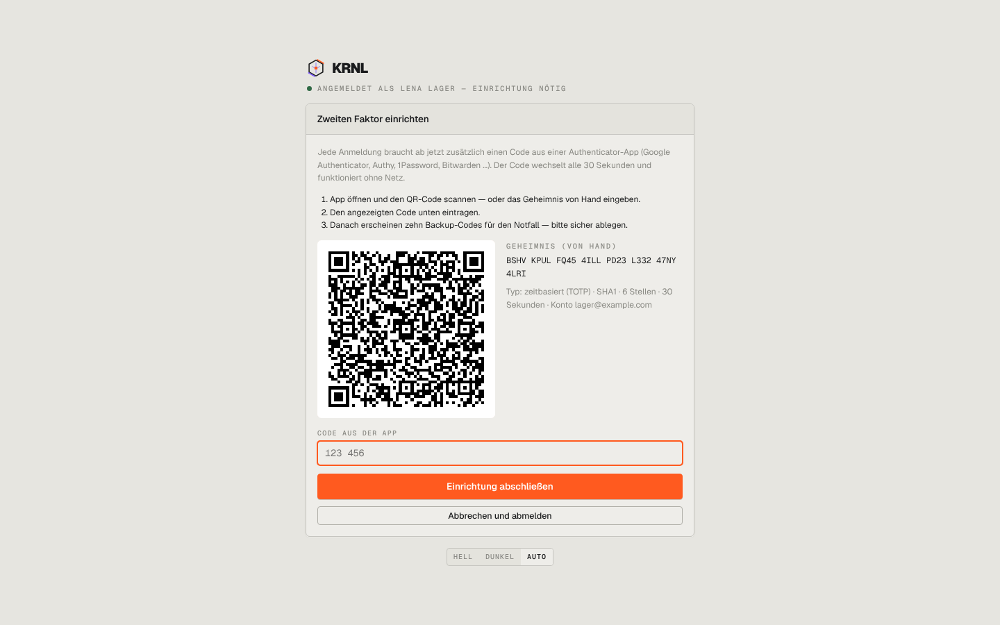

# 004-login-einrichten — Zweiten Faktor einrichten

- **Bereich:** Anmeldung & öffentliche Seiten
- **Route:** `/login/einrichten`
- **Note:** 4 / 5
- **Zweck:** Pflicht-Einrichtung des zweiten Faktors nach dem Passwort
- **Messwerte:** HTTP 200 · Ladezeit — ms · Seitenhöhe 900 px · horizontaler Überlauf nein · Texte < 11 px: —

## Was gut ist

- Drei nummerierte Schritte, QR + Geheimnis zum Abtippen in Vierergruppen
- Fokus sofort im Codefeld
- ‚Abbrechen und abmelden‘ als Ausweg

## Befunde

| Schwere | Kategorie | Befund | Vorschlag |
|---|---|---|---|
| **niedrig** | Texte | Technische Zeile ‚Typ: zeitbasiert (TOTP) · SHA1 · 6 Stellen · 30 Sekunden‘ für Anwender ohne Nutzen. | Einklappen (‚Probleme mit der App?‘). |
| **niedrig** | Typografie | Statuszeile ‚ANGEMELDET ALS LENA LAGER — EINRICHTUNG NÖTIG‘ in kleinen grauen Mono-Versalien – die wichtigste Information (warum bin ich hier?) ist am schwächsten gesetzt. | Normaler Satz in Textfarbe über der Karte. |

[← zur Übersicht](../README.md)
