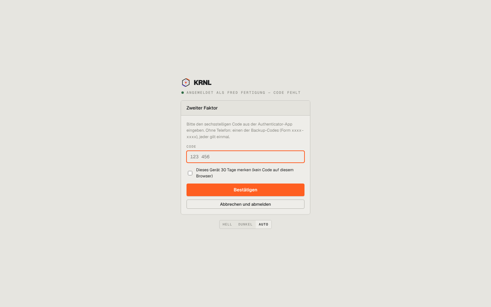

# 005-login-code — Zweiter Faktor: Code

- **Bereich:** Anmeldung & öffentliche Seiten
- **Route:** `/login/code`
- **Note:** 4 / 5
- **Zweck:** Code des zweiten Faktors eingeben
- **Messwerte:** HTTP 200 · Ladezeit — ms · Seitenhöhe 900 px · horizontaler Überlauf nein · Texte < 11 px: —

## Was gut ist

- Kurz und klar, Backup-Code-Hinweis
- ‚Gerät 30 Tage merken‘

## Befunde

| Schwere | Kategorie | Befund | Vorschlag |
|---|---|---|---|
| **niedrig** | Eingabe | Kein inputmode=numeric/Autofill-Hinweis sichtbar; Platzhalter ‚123 456‘ könnte als Vorgabe missverstanden werden. | Sechs Einzelziffernfelder oder numerische Tastatur, Autofill (one-time-code). |
| **niedrig** | Layout | Karte schmaler als bei der Einrichtung (004) – zwei Breiten im selben Ablauf. | Einheitliche Kartenbreite im Login. |

[← zur Übersicht](../README.md)
