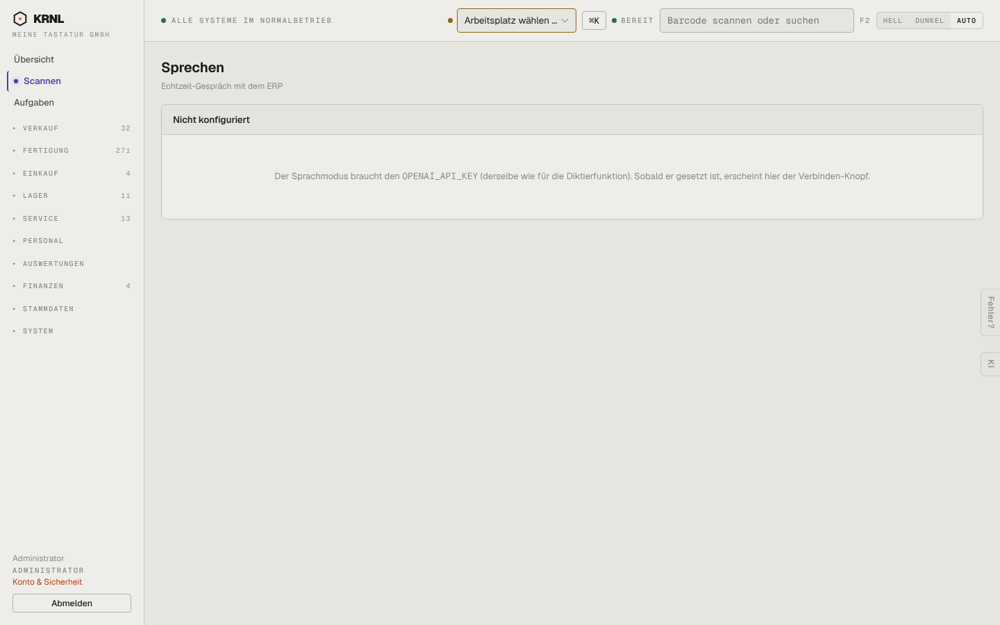

# 011-sprechen — Sprechen

- **Bereich:** Kopf & Rahmen
- **Route:** `/sprechen`
- **Note:** 2 / 5
- **Zweck:** Echtzeit-Sprachmodus.
- **Messwerte:** HTTP 200 · Ladezeit 771 ms · Seitenhöhe 900 px · horizontaler Überlauf nein · Texte < 11 px: 13

## Was gut ist

- Ehrlicher Hinweis statt kaputter Funktion.

## Befunde

| Schwere | Kategorie | Befund | Vorschlag |
|---|---|---|---|
| **mittel** | Texte | Technischer Hinweis „braucht den OPENAI_API_KEY“ — für Mitarbeiter unverständlich; Seite ist über URL/Befehlsfeld erreichbar, obwohl der Menüpunkt fehlt. | Für Nicht-Admins: „Sprachmodus ist nicht freigeschaltet — frag deinen Administrator“; für Admins Link zu Einstellungen → KI. |
| **niedrig** | Layout | Leere Karte über volle Breite mit einem Satz; 80 % der Seite leer. | Kompakter Leerzustand mit Illustration/Erklärung, was Sprechen kann. |

[← zur Übersicht](../README.md)
