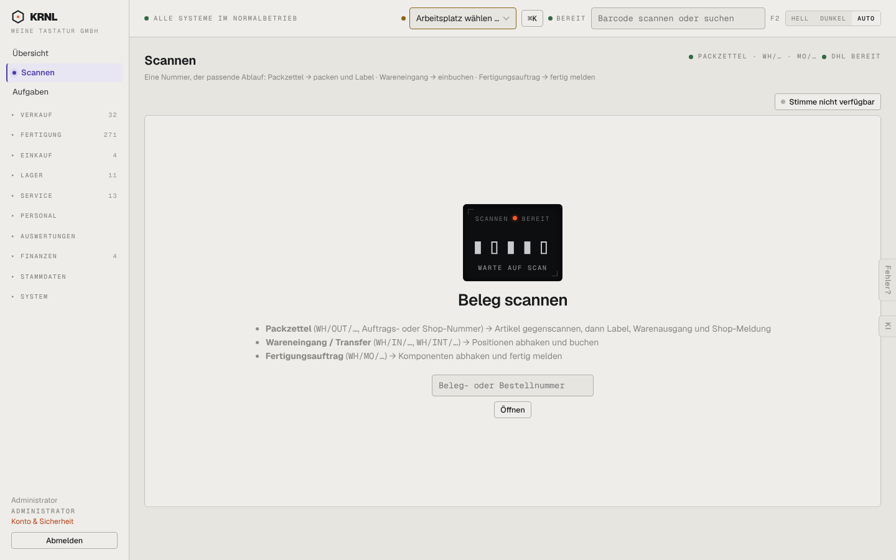

# 012-scanner — Scannen

- **Bereich:** Kopf & Rahmen
- **Route:** `/scanner`
- **Note:** 3 / 5
- **Zweck:** Ein Scanfeld für Packzettel, Wareneingang, Fertigungsauftrag.
- **Messwerte:** HTTP 200 · Ladezeit 749 ms · Seitenhöhe 900 px · horizontaler Überlauf nein · Texte < 11 px: 17

## Was gut ist

- Erklärung, welche Nummern was auslösen.
- Display-Element „Warte auf Scan“ signalisiert Bereitschaft.

## Befunde

| Schwere | Kategorie | Befund | Vorschlag |
|---|---|---|---|
| **hoch** | Layout | Das eigentliche Eingabefeld ist klein (260 px) und der „Öffnen“-Knopf winzig, während die Fläche drumherum riesig und leer ist — am Packtisch mit Handscanner unkritisch, auf Touch/Tablet zu klein. | Großes Eingabefeld (volle Kartenbreite, 48 px hoch), großer Knopf, Autofokus sichtbar. |
| **mittel** | Konsistenz | Zwei Scanfelder gleichzeitig (Kopfleiste „Barcode scannen oder suchen“ und Seite „Beleg- oder Bestellnummer“) — welches gilt? | Auf /scanner das Kopf-Feld ausblenden oder beide verbinden. |
| **mittel** | Texte | Statuszeile oben rechts „PACKZETTEL · WH/… · MO/… · DHL BEREIT“ ist abgeschnitten (Ellipsen) und kryptisch. | Ausgeschrieben: „Erkennt: Packzettel, Wareneingang, Fertigung · DHL verbunden“. |
| **niedrig** | Funktion | „Stimme nicht verfügbar“ als Knopf-Optik, obwohl nicht klickbar. | Als Hinweistext/Badge darstellen. |

[← zur Übersicht](../README.md)
