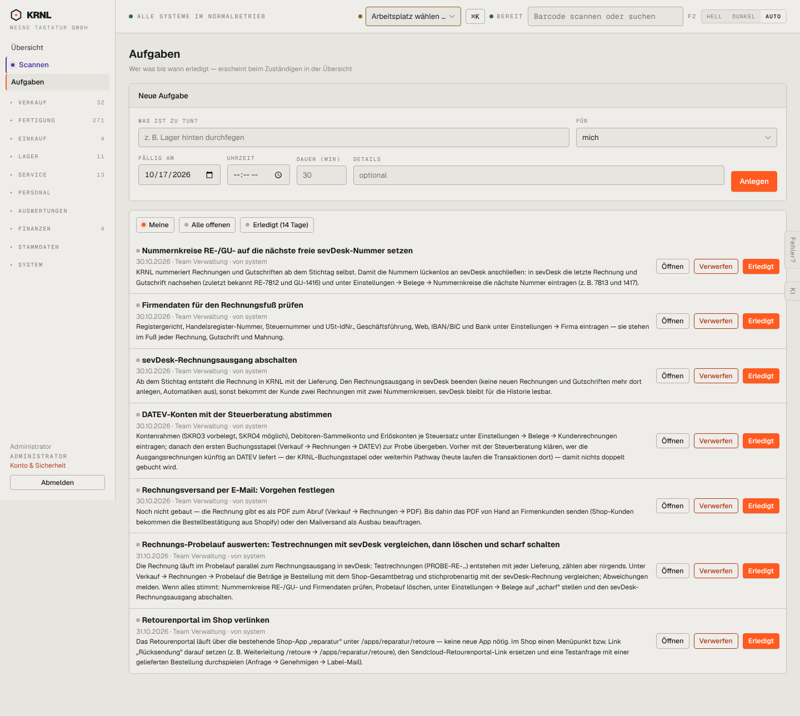

# 013-aufgaben — Aufgaben

- **Bereich:** Kopf & Rahmen
- **Route:** `/aufgaben`
- **Note:** 3 / 5
- **Zweck:** Aufgaben anlegen, zuweisen, abhaken; Einrichtungsaufgaben des Betreibers.
- **Messwerte:** HTTP 200 · Ladezeit 770 ms · Seitenhöhe 1289 px · horizontaler Überlauf nein · Texte < 11 px: 19

## Was gut ist

- Anlegen direkt oben, Filter Meine/Alle/Erledigt klar.
- Einrichtungsaufgaben mit ausführlicher Erklärung und Fälligkeit.

## Befunde

| Schwere | Kategorie | Befund | Vorschlag |
|---|---|---|---|
| **hoch** | Layout | Drei gleich starke Knöpfe je Zeile (Öffnen, Verwerfen, Erledigt) — „Verwerfen“ in Rot-Kontur gleichrangig neben der Primäraktion; bei 7 Aufgaben 21 laute Knöpfe. | Primär „Erledigt“ (Häkchen links als Checkbox), „Öffnen“ als Zeilenklick, „Verwerfen“ ins Mehr-Menü. |
| **mittel** | Layout | Lange Beschreibungstexte stehen voll ausgeklappt in der Liste — die Liste wird zur Textwand. | Zwei Zeilen mit „mehr“, oder Beschreibung erst im Detail. |
| **mittel** | Status | Kein sichtbarer Unterschied zwischen fällig/überfällig/später; der graue Punkt vor dem Titel trägt keine Information. | Fälligkeitsfarbe (überfällig rot, heute orange, später neutral) und Gruppierung nach Fälligkeit. |
| **niedrig** | Konsistenz | Datumsfeld zeigt amerikanisches Format „10/17/2026“ (Browser-Locale), sonst überall deutsch. | Eigenes Datumsfeld mit TT.MM.JJJJ oder lang=de am Input. |
| **niedrig** | Texte | „von system“ klein geschrieben, technischer Akteur sichtbar. | „automatisch angelegt“. |

[← zur Übersicht](../README.md)
