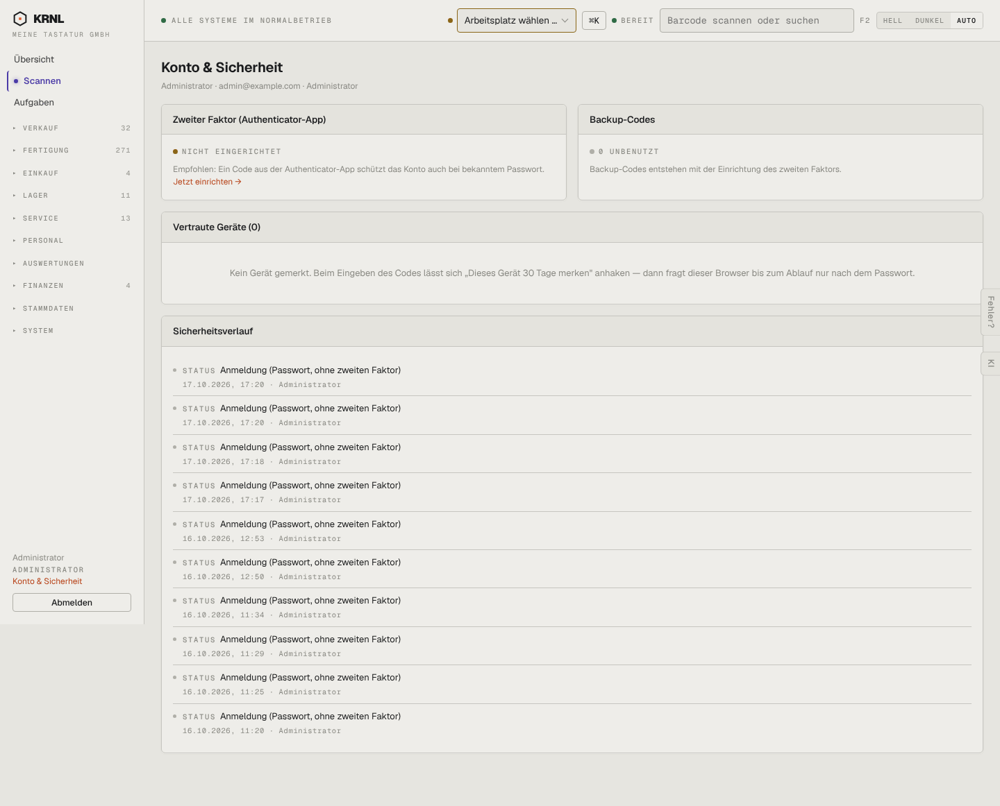

# 014-konto — Mein Konto

- **Bereich:** Kopf & Rahmen
- **Route:** `/konto`
- **Note:** 4 / 5
- **Zweck:** Eigenes Konto: zweiter Faktor, Backup-Codes, vertraute Geräte, Sicherheitsverlauf.
- **Messwerte:** HTTP 200 · Ladezeit 823 ms · Seitenhöhe 1162 px · horizontaler Überlauf nein · Texte < 11 px: 33

## Was gut ist

- Klare Kartenstruktur, Status „nicht eingerichtet“ mit Handlungsaufforderung.

## Befunde

| Schwere | Kategorie | Befund | Vorschlag |
|---|---|---|---|
| **mittel** | Funktion | Kein Passwort ändern, kein Name/E-Mail ändern auf der Kontoseite. | Karte „Profil & Passwort“. |
| **niedrig** | Layout | Sicherheitsverlauf: jede Zeile trägt das Wort „STATUS“ als Label — redundant, zehn identische Zeilen ohne Gruppierung. | Tabelle Datum · Ereignis · Gerät/IP, gleiche Ereignisse gruppieren, „mehr laden“. |
| **niedrig** | Status | Zweiter Faktor fehlt — wichtigster Hinweis der Seite ist ein kleiner Link „Jetzt einrichten →“. | Primärknopf in der Karte, Warnfarbe am Kartenrand. |

[← zur Übersicht](../README.md)
