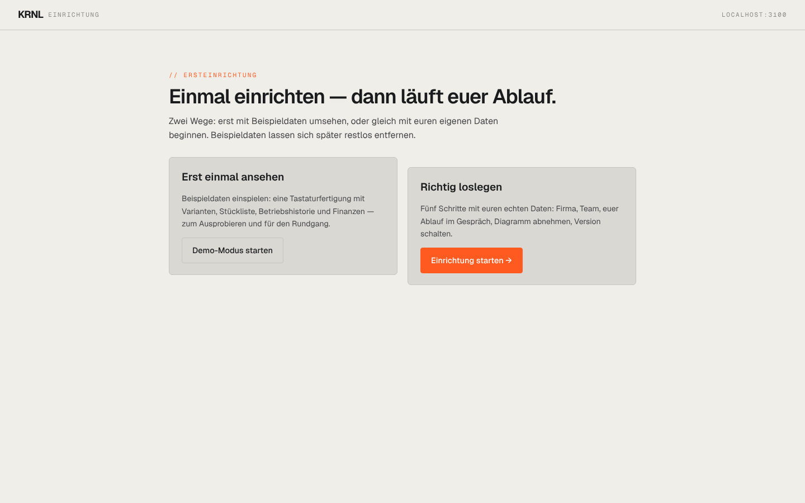

# 015-einrichtung — Einrichtung (Onboarding)

- **Bereich:** Kopf & Rahmen
- **Route:** `/einrichtung`
- **Note:** 4 / 5
- **Zweck:** Ersteinrichtung: Demo-Modus oder echte Einrichtung starten.
- **Messwerte:** HTTP 200 · Ladezeit 611 ms · Seitenhöhe 900 px · horizontaler Überlauf nein · Texte < 11 px: 0

## Was gut ist

- Zwei klare Wege, primärer Weg farblich hervorgehoben.

## Befunde

| Schwere | Kategorie | Befund | Vorschlag |
|---|---|---|---|
| **mittel** | Logik | Die Seite ist für einen eingerichteten Betrieb (mit Daten) weiter erreichbar und bietet „Demo-Modus starten“ an — Gefahr, Beispieldaten in Produktivdaten zu mischen. | Nach abgeschlossener Einrichtung nur noch Status/„erneut ansehen“, Demo-Knopf sperren. |
| **niedrig** | Layout | Die beiden Karten sind unterschiedlich hoch und vertikal versetzt (rechte Karte beginnt tiefer). | Gleiche Höhe und Oberkante. |
| **niedrig** | Texte | Kopfzeile zeigt technischen Host „LOCALHOST:3100“. | Firmenname bzw. Instanzname statt Host. |

[← zur Übersicht](../README.md)
