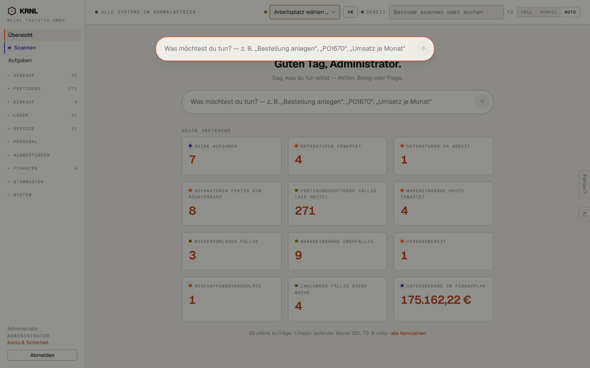

# 016-befehlsfeld — Befehlsfeld (Strg+K)

- **Bereich:** Kopf & Rahmen
- **Route:** `/`
- **Note:** 3 / 5
- **Zweck:** Befehlsfeld (Strg/Cmd+K) über jeder Seite.
- **Messwerte:** HTTP 200 · Ladezeit 3746 ms · Seitenhöhe 900 px · horizontaler Überlauf nein · Texte < 11 px: 14

## Was gut ist

- Überall erreichbar, abgedunkelter Hintergrund fokussiert.

## Befunde

| Schwere | Kategorie | Befund | Vorschlag |
|---|---|---|---|
| **mittel** | Layout | Das Overlay erscheint ohne Vorschläge/zuletzt genutzt — ein leeres Feld; der Nutzer weiß nicht, was möglich ist. | Beim Öffnen 5 Vorschläge (zuletzt genutzt, häufigste Aktionen, Navigation) zeigen. |
| **niedrig** | Layout | Overlay überdeckt die Seitenüberschrift halb („Guten Tag“ schaut darunter hervor). | Overlay tiefer setzen oder Hintergrund stärker abdunkeln. |
| **niedrig** | Konsistenz | Kopfleiste zeigt „⌘K“ auch auf Windows/Linux. | Plattformabhängig „Strg K“. |

[← zur Übersicht](../README.md)
