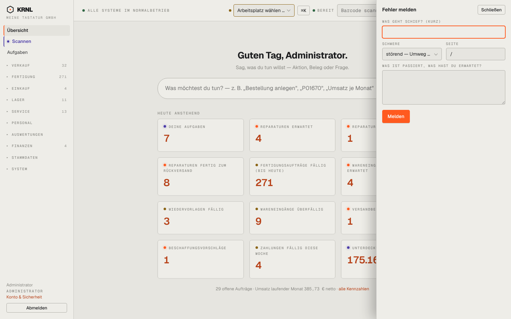

# 017-fehler-melden — Fehler melden (Dialog)

- **Bereich:** Kopf & Rahmen
- **Route:** `/`
- **Note:** 3 / 5
- **Zweck:** Fehler/Wunsch aus jeder Seite melden (Schublade rechts)
- **Messwerte:** HTTP 200 · Ladezeit 3572 ms · Seitenhöhe 900 px · horizontaler Überlauf nein · Texte < 11 px: 14

## Was gut ist

- Seite wird automatisch vorbelegt
- Fokus sofort im ersten Feld (orange Rahmen)
- Schwere-Auswahl vorhanden

## Befunde

| Schwere | Kategorie | Befund | Vorschlag |
|---|---|---|---|
| **mittel** | Layout | Schublade überdeckt rechts den Inhalt ohne Abdunklung des Hintergrunds; Übersichtskacheln werden mittig abgeschnitten (‚Unterdeck… 175.16‘). | Halbtransparente Abdunklung oder Inhalt zusammenschieben. |
| **niedrig** | Eingabe | Schwere-Auswahl abgeschnitten (‚störend — Umweg …‘); Feld ‚Seite‘ zeigt nur ‚/‘ statt Seitentitel. | Breitere Auswahl, Seitentitel statt Pfad. |
| **niedrig** | Funktion | Kein Screenshot-Anhang/keine automatische Bildschirmaufnahme – bei UI-Fehlern das wichtigste Beweismittel. | Option ‚Bildschirmfoto anhängen‘. |
| **niedrig** | Navigation | In der Seitenleiste sind gleichzeitig ‚Übersicht‘ (aktiv) und ‚Scannen‘ (Punkt, blau) hervorgehoben – zwei aktive Zustände. | Siehe A00-rahmen: nur ein aktiver Menüpunkt. |

[← zur Übersicht](../README.md)
