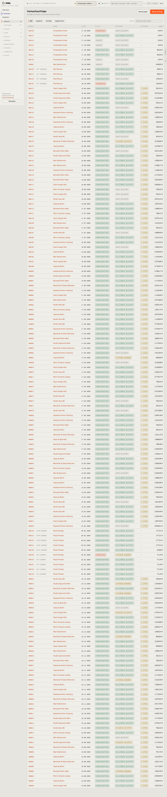

# 100-verkauf — Verkaufsaufträge

- **Bereich:** Verkauf
- **Route:** `/verkauf`
- **Note:** 3 / 5
- **Zweck:** Liste aller Verkaufsaufträge (Shop und manuell) mit Status, Lieferung, Fertigung, Summe.
- **Messwerte:** HTTP 200 · Ladezeit 1116 ms · Seitenhöhe 6840 px · horizontaler Überlauf nein · Texte < 11 px: 473

## Was gut ist

- Drei Statusdimensionen (Beleg, Lieferung, Fertigung) nebeneinander — viel Information auf einen Blick.
- Shop-Bestellnummer neben der KRNL-Nummer.

## Befunde

| Schwere | Kategorie | Befund | Vorschlag |
|---|---|---|---|
| **hoch** | Leistung | Keine Seitenaufteilung: rund 150 Aufträge auf einer 6.800 px hohen Seite; mit echten Daten wird das unbenutzbar langsam. | Pagination oder „mehr laden“, Standardfilter „offen“, Zahl der Treffer anzeigen. |
| **hoch** | Logik | Viele Aufträge sind „vollständig geliefert“ und zeigen gleichzeitig „Fertigung 2 offen“ — ein Widerspruch, der den Nutzer verunsichert (gefertigt wird nach der Lieferung?). | Offene Fertigung bei vollständig geliefertem Auftrag als Klärfall markieren oder ausblenden; Zustand erklären. |
| **mittel** | Status | Spalte „Status“ zeigt den Belegtyp (ANGEBOT / VERKAUFSAUFTRAG / ABGEBROCHEN), nicht den Fortschritt; der eigentliche Fortschritt steckt in drei weiteren Spalten. | Ein zusammengefasster Status (Angebot · Offen · In Fertigung · Versandbereit · Geliefert · Abgebrochen) plus Detail-Badges im Hover. |
| **mittel** | Filter | Filter nur Alle/Angebote/Aufträge/Abgebrochen — kein „zu liefern“, „wartet auf Fertigung“, „Shop/Manuell“, Zeitraum; keine Sortierung per Spaltenkopf. | Filterchips nach Arbeitszustand, Quelle, Zeitraum; sortierbare Spalten. |
| **mittel** | Typografie | Nummer und Kunde sind beide in Akzent-Orange als Link — die Tabelle wird sehr orange, die Summe tritt zurück. | Nur die Nummer als Link (oder ganze Zeile klickbar), Kunde in Textfarbe. |
| **niedrig** | Typografie | Alle Badges in Mono-Versalien mit Rahmen — sechs Badge-Farben pro Zeile erzeugen Unruhe. | Badges in Satzschreibung, weiche Fläche statt Rahmen, nur Abweichungen farbig. |

[← zur Übersicht](../README.md)
