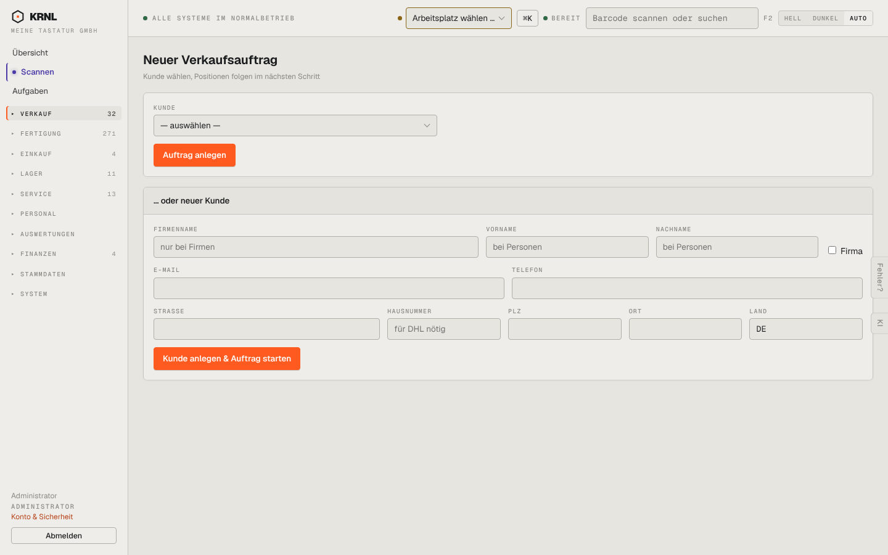

# 101-verkauf-neu — Neuer Verkaufsauftrag

- **Bereich:** Verkauf
- **Route:** `/verkauf/neu`
- **Note:** 3 / 5
- **Zweck:** Neuen Verkaufsauftrag anlegen: Kunde wählen oder neuen Kunden anlegen.
- **Messwerte:** HTTP 200 · Ladezeit 783 ms · Seitenhöhe 900 px · horizontaler Überlauf nein · Texte < 11 px: 24

## Was gut ist

- Zwei klare Wege (bestehender oder neuer Kunde).

## Befunde

| Schwere | Kategorie | Befund | Vorschlag |
|---|---|---|---|
| **mittel** | Schritte | „Positionen folgen im nächsten Schritt“ — der Nutzer sieht nicht, wie viele Schritte es gibt und was danach kommt. | Schrittanzeige (1 Kunde · 2 Positionen · 3 Bestätigen) oder Positionen direkt auf derselben Seite. |
| **mittel** | Layout | Checkbox „Firma“ hängt rechts außen neben Nachname; Firmenname/Vorname/Nachname stehen gleichzeitig offen — unklar, was man ausfüllen muss. | Umschalter „Firma / Privatperson“ vorne, passende Felder ein-/ausblenden. |
| **niedrig** | Eingabe | Land ist freies Textfeld mit „DE“; Platzhalter „für DHL nötig“ nur im Hausnummernfeld. | Länderauswahl; Pflichtfelder für Versand mit Stern kennzeichnen. |

[← zur Übersicht](../README.md)
