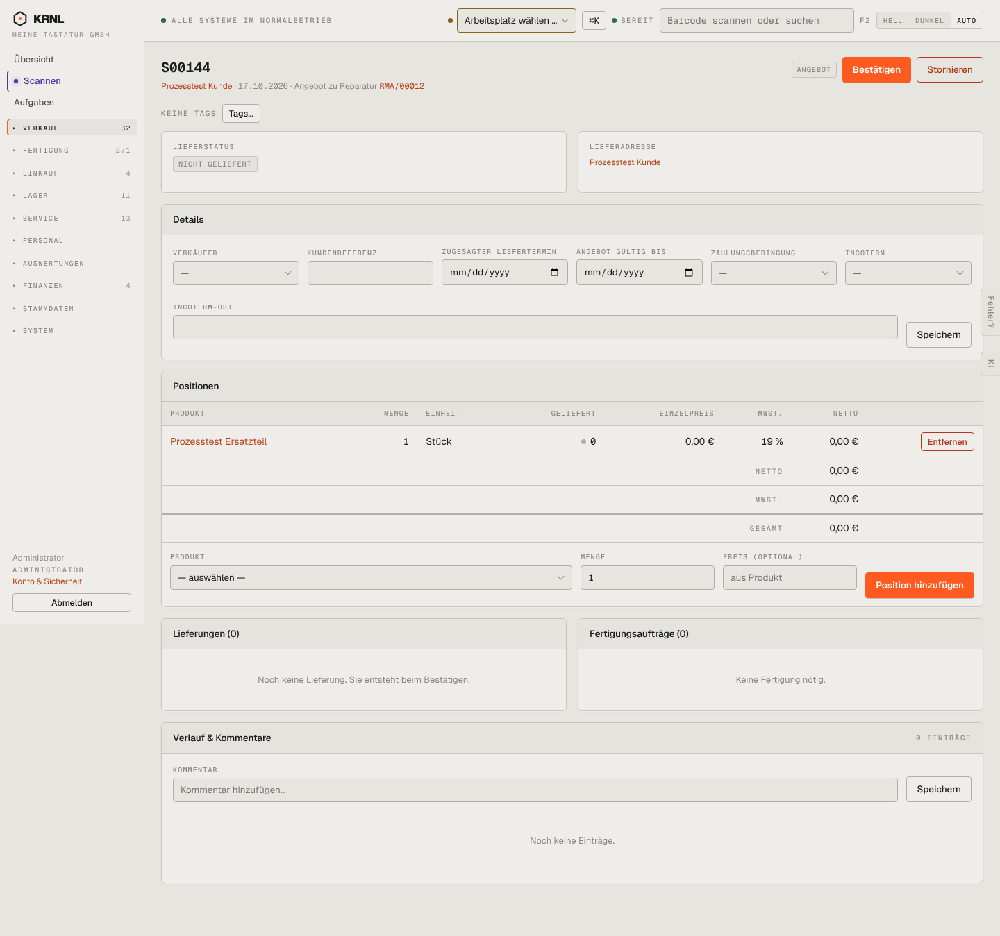

# 102-verkauf-entwurf — Auftrag Entwurf

- **Bereich:** Verkauf
- **Route:** `/verkauf/07aabd81-2887-46fd-b88f-292a1602a629`
- **Note:** 3 / 5
- **Zweck:** Angebot (Entwurf) eines Verkaufsauftrags ansehen, Positionen pflegen, bestätigen
- **Messwerte:** HTTP 200 · Ladezeit 790 ms · Seitenhöhe 1349 px · horizontaler Überlauf nein · Texte < 11 px: 41

## Was gut ist

- Klare Primäraktion „Bestätigen“ oben rechts
- Leerzustände der Karten Lieferungen/Fertigung erklären, was beim Bestätigen passiert (‚Sie entsteht beim Bestätigen‘)
- Herkunft ‚Angebot zu Reparatur RMA/00012‘ verlinkt

## Befunde

| Schwere | Kategorie | Befund | Vorschlag |
|---|---|---|---|
| **hoch** | Status | Der Status steht nur als kleines graues Etikett „ANGEBOT“ neben den Knöpfen; es gibt keine Statusleiste/Prozessanzeige (Angebot → Auftrag → geliefert → berechnet). Die Retoure hat ein Prozess-Panel, der Verkaufsauftrag nicht – inkonsistent zum Grundsatz ‚Prozess First‘. | Einheitliche Stufenleiste (Stepper) im Kopf aller Belege, aktueller Schritt hervorgehoben, nächste Aktion daneben. |
| **hoch** | Eingabe | Datumsfelder „Zugesagter Liefertermin“ und „Angebot gültig bis“ zeigen das US-Format mm/dd/yyyy (Browser-Locale statt de-DE). | Eigene Datumskomponente oder lang="de" am Dokument; Anzeige TT.MM.JJJJ. |
| **mittel** | Funktion | Kein Weg, das Angebot als PDF zu erzeugen oder an den Kunden zu senden – ein Angebot ohne ‚Senden/Drucken‘ ist nur ein Entwurf. | Aktion „Angebot senden (PDF)“ als zweite Aktion im Kopf; Gültigkeit aus dem Feld übernehmen. |
| **mittel** | Daten | Ersatzteil-Position mit 0,00 € ohne Hinweis – bei einem Angebot zur Reparatur unklar, ob gewollt (Gewährleistung) oder vergessen. | Hinweis ‚Preis 0 € – Gewährleistung?‘ bzw. Pflichtbestätigung vor dem Bestätigen. |
| **mittel** | Layout | Details-Karte nimmt ein Drittel der Seite ein, sechs leere Felder (Verkäufer, Incoterm, Incoterm-Ort …) mit eigenem Speichern-Knopf; Positionen (das Wichtigste) rutschen nach unten. | Details einklappbar bzw. als Seitenleiste; Incoterm-Felder nur bei Auslandskunden; Autosave statt separatem Speichern. |
| **niedrig** | Daten | Lieferadresse zeigt nur den Namen ‚Prozesstest Kunde‘ ohne Straße/Ort. | Vollständige Adresse oder Hinweis ‚Adresse fehlt – ergänzen‘. |
| **niedrig** | Konsistenz | „Stornieren“ steht gleichrangig (rot umrandet) direkt neben „Bestätigen“ – destruktive Aktion zu prominent. | Stornieren in ein Mehr-Menü (⋯) verschieben. |

[← zur Übersicht](../README.md)
