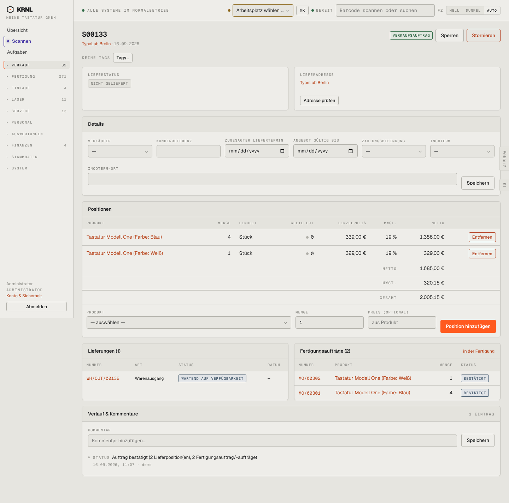

# 103-verkauf-bestaetigt — Auftrag bestätigt, offen

- **Bereich:** Verkauf
- **Route:** `/verkauf/406c7929-0feb-43e1-8ac7-236f175341de`
- **Note:** 3 / 5
- **Zweck:** Bestätigten Auftrag verfolgen: Lieferung wartet auf Fertigung
- **Messwerte:** HTTP 200 · Ladezeit 823 ms · Seitenhöhe 1425 px · horizontaler Überlauf nein · Texte < 11 px: 54

## Was gut ist

- Lieferungen und Fertigungsaufträge direkt am Auftrag mit Status
- Verlauf erklärt, was beim Bestätigen entstand
- Hinweis ‚in der Fertigung‘ an der Fertigungskarte

## Befunde

| Schwere | Kategorie | Befund | Vorschlag |
|---|---|---|---|
| **hoch** | Logik | Nach der Bestätigung sind Positionen weiterhin per „Entfernen“ löschbar und „Position hinzufügen“ ist aktiv, obwohl Lieferung und zwei Fertigungsaufträge existieren. Was mit Lieferung/FA passiert, ist nicht erkennbar. | Positionen nach Bestätigung sperren oder Änderung nur über eine bewusste Aktion ‚Auftrag ändern‘ mit Vorschau der Folgen (FA anpassen/stornieren). |
| **hoch** | Status | Statusetikett heißt „VERKAUFSAUFTRAG“ – das ist die Belegart, kein Zustand. Gleichzeitig ‚Lieferstatus: nicht geliefert‘, Lieferung ‚wartend auf Verfügbarkeit‘, FA ‚bestätigt‘: vier Statusbegriffe, keiner sagt ‚wartet auf Fertigung (0/5 gefertigt)‘. | Ein zusammengefasster Zustand im Kopf (z. B. ‚In Fertigung · 0 von 5 gefertigt · Liefertermin —‘) plus Stepper. |
| **mittel** | Texte | Knopf „Sperren“ ohne Erklärung – sperrt er Bearbeitung, Lieferung oder den Kunden? | Klare Beschriftung (‚Bearbeitung sperren‘) und Tooltip; selten genutzt → ins Mehr-Menü. |
| **mittel** | Logik | Feld „Angebot gültig bis“ wird auch beim bestätigten Auftrag angezeigt und ist editierbar. | Felder je Status ein-/ausblenden (Angebotsfelder nur im Angebot). |
| **niedrig** | Texte | Verlaufstext „2 Lieferposition(en), 2 Fertigungsauftrag/-aufträge“ – Klammer-Plural. | Plural per Zahl auflösen (‚2 Fertigungsaufträge‘). |
| **niedrig** | Daten | Kein zugesagter Liefertermin gesetzt und kein Hinweis darauf; die Lieferung zeigt Datum ‚—‘. | Voraussichtlichen Termin aus FA-Planung anzeigen. |

[← zur Übersicht](../README.md)
