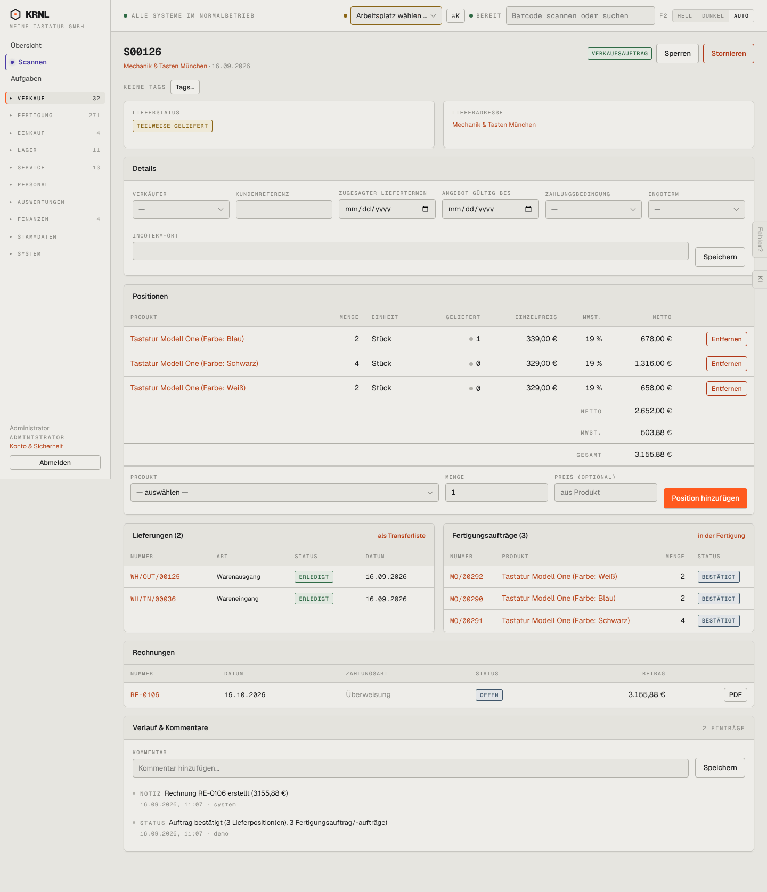

# 104-verkauf-teilgeliefert — Auftrag teilgeliefert

- **Bereich:** Verkauf
- **Route:** `/verkauf/51ae1eca-7d35-41ae-a265-4509e45d738c`
- **Note:** 2 / 5
- **Zweck:** Teilweise gelieferten Auftrag prüfen
- **Messwerte:** HTTP 200 · Ladezeit 812 ms · Seitenhöhe 1675 px · horizontaler Überlauf nein · Texte < 11 px: 64

## Was gut ist

- Lieferstatus ‚teilweise geliefert‘ farblich gelb abgesetzt
- Rechnung mit PDF direkt am Auftrag

## Befunde

| Schwere | Kategorie | Befund | Vorschlag |
|---|---|---|---|
| **kritisch** | Logik | ‚Teilweise geliefert‘ (1 von 8 Stück), aber unter Lieferungen steht keine offene Restlieferung – nur WH/OUT/00125 (erledigt) und ein Wareneingang WH/IN/00036. Wo der Rest bleibt, ist nicht zu sehen. | Restlieferung (Backorder) immer anzeigen bzw. deutlich ‚Rest: 7 Stück ohne Lieferung – anlegen‘ melden. |
| **hoch** | Logik | Rechnung RE-0106 über den vollen Betrag 3.155,88 €, obwohl erst 1 von 8 Stück geliefert ist. Zudem Datum 16.10.2026 in der Tabelle, laut Verlauf am 16.09.2026 erstellt. | Rechnung nur über Geliefertes (oder deutlich als Vorauskasse kennzeichnen); Rechnungsdatum und Verlaufsdatum angleichen. |
| **hoch** | Daten | Blau: 1 von 2 geliefert, der zugehörige FA MO/00290 über 2 Stück steht weiter auf ‚bestätigt‘ (nichts gefertigt). Woher das gelieferte Stück kam, ist nicht nachvollziehbar. | FA-Menge mit Lieferung abgleichen oder Herkunft (Lagerbestand) zeigen. |
| **mittel** | Logik | Wareneingang WH/IN/00036 unter ‚Lieferungen‘ eines Verkaufsauftrags ohne Erklärung (Rücksendung? Umlagerung?). | Art sprechend benennen (‚Rücklieferung vom Kunden‘) oder in eigene Gruppe. |
| **mittel** | Logik | „Entfernen“ auch bei einer bereits teilweise gelieferten Position (Blau, 1 geliefert). | Entfernen sperren, sobald geliefert > 0. |
| **niedrig** | Texte | Link „als Transferliste“ an der Lieferkarte ist unverständlich. | ‚Alle Lagerbewegungen anzeigen‘. |

[← zur Übersicht](../README.md)
