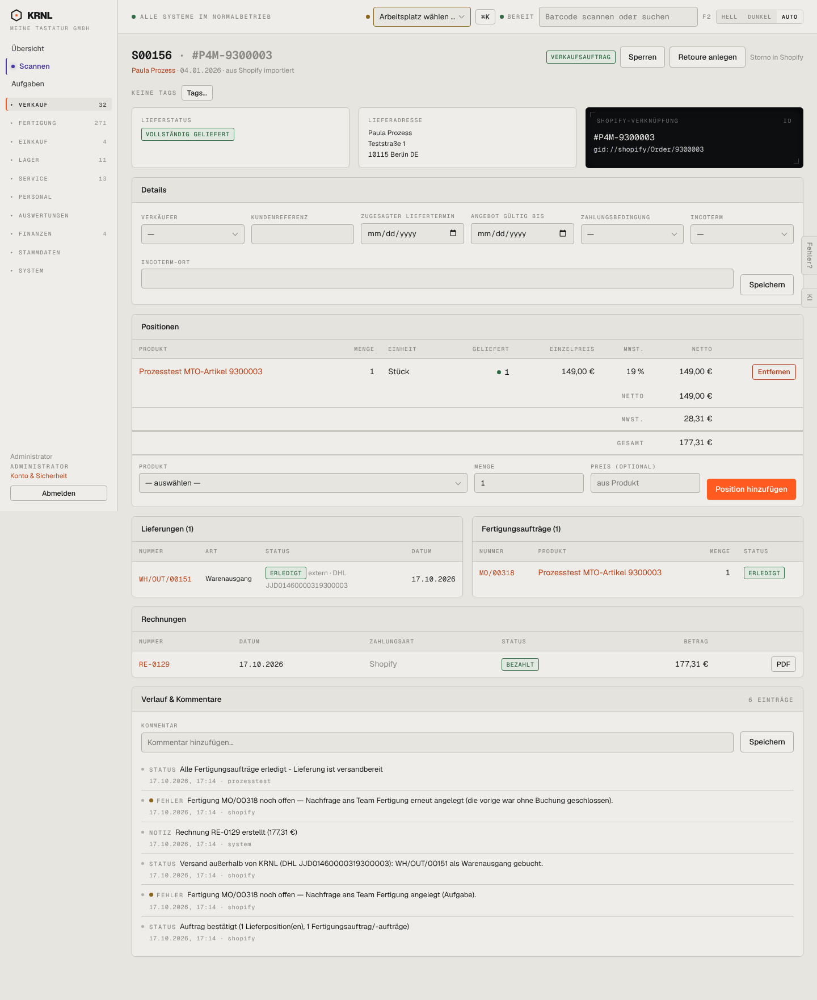

# 105-verkauf-shop-geliefert — Shop-Auftrag geliefert

- **Bereich:** Verkauf
- **Route:** `/verkauf/bc4fecaf-459c-474c-bd95-4abb395ecf09`
- **Note:** 3 / 5
- **Zweck:** Geliefertes, bezahltes Shop-Auftrag prüfen, ggf. Retoure anlegen
- **Messwerte:** HTTP 200 · Ladezeit 863 ms · Seitenhöhe 1761 px · horizontaler Überlauf nein · Texte < 11 px: 70

## Was gut ist

- Shop-Nummer neben KRNL-Nummer im Titel
- Vollständige Lieferadresse, Sendungsnummer an der Lieferung
- Retoure anlegen direkt im Kopf
- Verlauf zeigt Herkunft (shopify/system/prozesstest)

## Befunde

| Schwere | Kategorie | Befund | Vorschlag |
|---|---|---|---|
| **hoch** | Logik | Shop-Auftrag ist vollständig geliefert und bezahlt, trotzdem sind „Entfernen“ und „Position hinzufügen“ aktiv. Änderungen kollidieren mit Shopify als Quelle und der gestellten Rechnung. | Shop-Aufträge: Positionen schreibgeschützt (‚Änderungen im Shopify-Admin‘). |
| **mittel** | Konsistenz | Die Shopify-Verknüpfung ist als einzige Karte schwarz (Terminal-Optik) – stärkster Kontrast der Seite für die unwichtigste Information (GID). | Gleiche Kartenoptik wie Lieferadresse; Link ‚In Shopify öffnen‘ statt roher GID. |
| **mittel** | Konsistenz | „Storno in Shopify“ ist grauer Text neben echten Knöpfen – wirkt wie deaktivierter Knopf. | Als Hinweis-Icon mit Tooltip oder im Mehr-Menü erklären. |
| **mittel** | Status | Verlauf zeigt zweimal gelb ‚FEHLER Fertigung MO/00318 noch offen‘, danach ‚Alle Fertigungsaufträge erledigt‘. Ob noch etwas zu tun ist, muss man aus der Reihenfolge erschließen. | Erledigte Warnungen als ‚behoben‘ markieren bzw. durchstreichen. |
| **niedrig** | Layout | Details (Verkäufer, Incoterm, Angebot gültig bis) für Shop-Aufträge irrelevant, nehmen aber viel Platz. | Für source=shopify ausblenden. |
| **niedrig** | Daten | Bestelldatum 04.01.2026 im Kopf, alle Ereignisse 17.10.2026 – Bestellung und Bearbeitung liegen 9 Monate auseinander (Testdaten), Seite zeigt aber keine Durchlaufzeit. | Optional ‚Durchlaufzeit Bestellung → Versand‘ anzeigen. |

[← zur Übersicht](../README.md)
