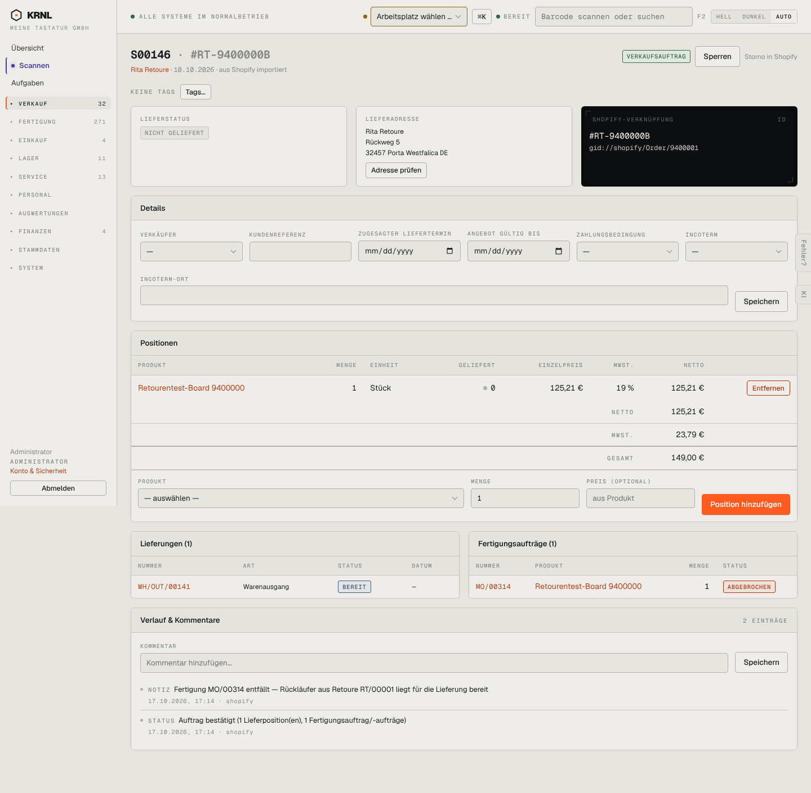

# 106-verkauf-shop-offen — Shop-Auftrag offen

- **Bereich:** Verkauf
- **Route:** `/verkauf/54a8e7f3-3a10-44f2-a8ba-1bf6859c43c9`
- **Note:** 3 / 5
- **Zweck:** Offener Shop-Auftrag, dessen Fertigung durch einen Rückläufer entfiel
- **Messwerte:** HTTP 200 · Ladezeit 793 ms · Seitenhöhe 1411 px · horizontaler Überlauf nein · Texte < 11 px: 56

## Was gut ist

- Verlauf erklärt klar: ‚Fertigung MO/00314 entfällt — Rückläufer aus Retoure RT/00001 liegt bereit‘
- Lieferung steht auf ‚bereit‘

## Befunde

| Schwere | Kategorie | Befund | Vorschlag |
|---|---|---|---|
| **mittel** | Status | Der entfallene FA wird rot als „ABGEBROCHEN“ angezeigt – liest sich wie ein Fehler, obwohl es der gewünschte Effekt (Rückläufer) ist. | Eigene Kennzeichnung ‚entfallen (Rückläufer)‘ in neutraler Farbe, Link zur Retoure in der FA-Zeile. |
| **mittel** | Logik | Lieferung ‚bereit‘, aber keine Aktion ‚Kommissionieren/Versenden‘ am Auftrag; man muss wissen, dass das im Versand passiert. | Nächster Schritt als Knopf (‚Zur Kommissionierung‘). |
| **niedrig** | Logik | Wie bei 105: Positionen bei Shop-Auftrag änderbar. | Schreibschutz für Shop-Aufträge. |

[← zur Übersicht](../README.md)
