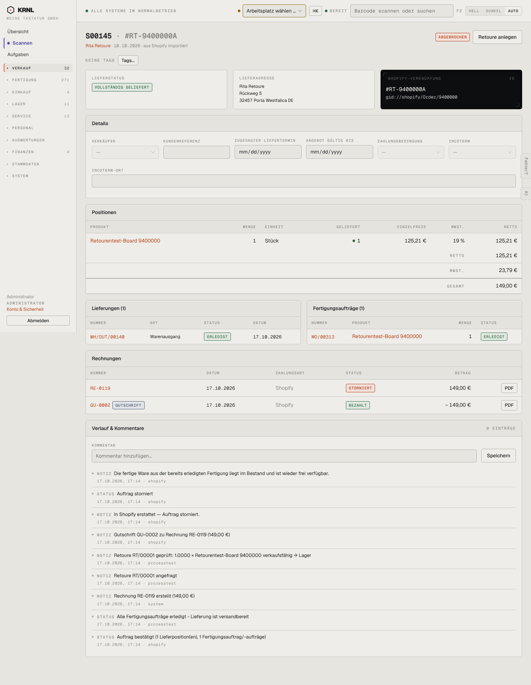

# 107-verkauf-storniert — Auftrag storniert

- **Bereich:** Verkauf
- **Route:** `/verkauf/e25f721e-e1d3-4dda-8f40-7333fdb91687`
- **Note:** 2 / 5
- **Zweck:** Stornierten (im Shop erstatteten) Auftrag nachvollziehen
- **Messwerte:** HTTP 200 · Ladezeit 811 ms · Seitenhöhe 1856 px · horizontaler Überlauf nein · Texte < 11 px: 75

## Was gut ist

- Rechnung storniert + Gutschrift sauber nebeneinander
- Details-Formular ist ausgegraut (gesperrt)
- Verlauf vollständig

## Befunde

| Schwere | Kategorie | Befund | Vorschlag |
|---|---|---|---|
| **hoch** | Konsistenz | Status heißt beim Auftrag „ABGEBROCHEN“, bei der Rechnung „STORNIERT“, im Verlauf ‚Auftrag storniert‘ – drei Wörter für denselben Zustand. | Einheitlich ‚Storniert‘. |
| **hoch** | Logik | „Retoure anlegen“ wird weiter angeboten, obwohl schon Retoure RT/00001 existiert und der Auftrag storniert ist. Die bestehende Retoure ist nirgends verlinkt (keine Retouren-Karte). | Karte ‚Retouren‘ mit Link und Status; Knopf nur, wenn noch rücksendbare Menge übrig ist. |
| **mittel** | Status | ‚Vollständig geliefert‘ (grün) bei einem stornierten Auftrag, dessen Ware zurück ist – widersprüchlich. | Lieferstatus ‚zurückgegeben‘ bzw. Rückgabemenge anzeigen. |
| **mittel** | Texte | Verlaufstext ‚1.0000 × Retourentest-Board‘ – unformatierte Menge mit vier Nachkommastellen und Punkt. | Menge mit qty()-Formatierung (‚1 ב). |
| **niedrig** | Layout | Leeres, ausgegrautes Details-Formular nimmt Platz ein. | Bei stornierten Belegen nur gefüllte Felder als Text. |

[← zur Übersicht](../README.md)
