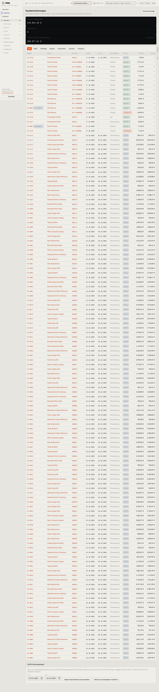

# 110-rechnungen — Kundenrechnungen

- **Bereich:** Verkauf
- **Route:** `/verkauf/rechnungen`
- **Note:** 2 / 5
- **Zweck:** Alle Kundenrechnungen und Gutschriften überblicken, offene Posten finden, DATEV-Export
- **Messwerte:** HTTP 200 · Ladezeit 1062 ms · Seitenhöhe 6233 px · horizontaler Überlauf nein · Texte < 11 px: 162

## Was gut ist

- Statusfilter als Chips (Alle/Offen/Überfällig/Bezahlt/Gutschriften/Storniert/Probelauf)
- Spalte ‚Offen‘ zeigt Restbetrag
- Gutschriften mit eigenem Etikett und negativem Betrag in der Liste

## Befunde

| Schwere | Kategorie | Befund | Vorschlag |
|---|---|---|---|
| **hoch** | Layout | Die drei Kennzahlen (Offene Forderungen, Überfällig, Umsatz) stehen als drei volle, schwarze Balken untereinander – ~250 px Höhe für drei Zahlen, stärkster Kontrast der Seite. | Kennzahlen in einer Zeile (3 Spalten), helle Karten, Akzentfarbe nur bei Handlungsbedarf (Überfällig > 0). |
| **hoch** | Leistung | 132 Belege auf einer Seite (6.233 px), keine Seitenaufteilung, keine Suche (Kunde, Nummer, Betrag), kein Datumsfilter. | Suchfeld + Zeitraumfilter + Seitenaufteilung (50) oder virtuelles Scrollen; Summen je Filter. |
| **hoch** | Status | Ob Rechnungen im Probelauf oder scharf laufen (heikles Thema laut Betreiber), ist auf der Liste nicht sichtbar – nur ein Filter-Chip ‚Probelauf‘ erklärt es versteckt. | Fester Modus-Hinweis im Kopf (‚Modus: Probelauf – Belege PROBE-RE‘ / ‚Scharf seit …‘). |
| **mittel** | Logik | RE-0130 über 0,00 € steht als ‚OFFEN‘, Spalte Offen ‚—‘ – Nullrechnung bleibt dauerhaft offen. | Nullrechnungen automatisch als ausgeglichen markieren oder gar nicht erzeugen. |
| **mittel** | Typografie | ‚Überfällig 0‘ ohne Währung, die anderen Kennzahlen mit ‚€‘. | Einheitlich ‚0,00 €‘ bzw. Anzahl + Betrag. |
| **mittel** | Logik | DATEV-Buchungsstapel steht unten auf der Rechnungsliste, obwohl die Buchhaltungsanbindung auf Hold ist; Datumsfelder im US-Format (10/01/2026). | Export in Finanzen/Einstellungen verschieben bzw. ausblenden, solange nicht aktiv; deutsches Datumsformat. |
| **niedrig** | Konsistenz | Spalte ‚Auftrag‘ mischt KRNL-Nummern (S00157) und Shop-Nummern (#P4M-9300003) ohne Kennzeichnung. | Beides zeigen oder Shop-Icon vor der Shop-Nummer. |

[← zur Übersicht](../README.md)
