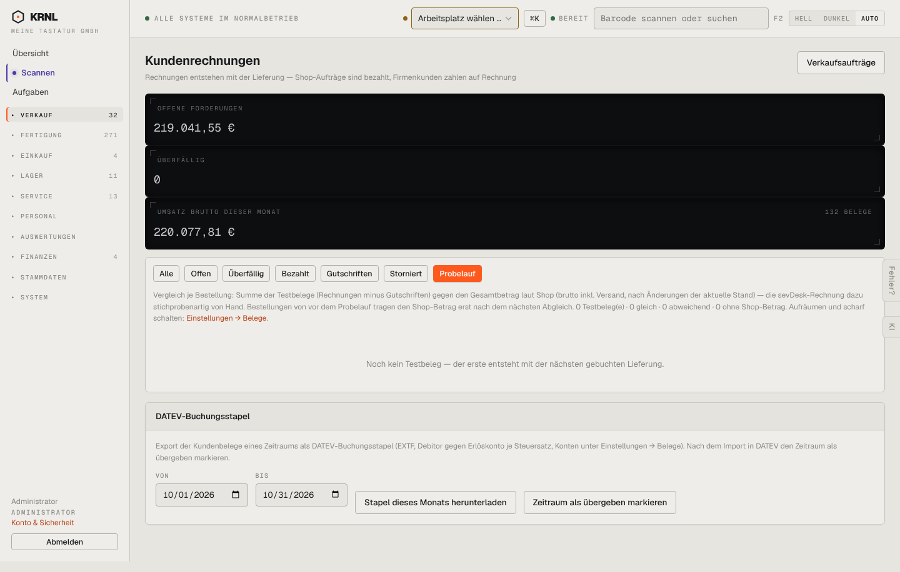

# 111-rechnungen-probelauf — Rechnungen Probelauf

- **Bereich:** Verkauf
- **Route:** `/verkauf/rechnungen?filter=probelauf`
- **Note:** 3 / 5
- **Zweck:** Testbelege des Rechnungs-Probelaufs mit Shopify vergleichen
- **Messwerte:** HTTP 200 · Ladezeit 807 ms · Seitenhöhe 917 px · horizontaler Überlauf nein · Texte < 11 px: 19

## Was gut ist

- Erklärtext zum Vergleich vorhanden, Link zu Einstellungen → Belege
- Leerzustand erklärt, wann der erste Testbeleg entsteht

## Befunde

| Schwere | Kategorie | Befund | Vorschlag |
|---|---|---|---|
| **mittel** | Texte | Erklärung ist ein dichter Absatz mit Zählern mitten im Satz (‚0 Testbeleg(e) · 0 gleich · 0 abweichend · 0 ohne Shop-Betrag‘). | Zähler als vier kleine Kennzahl-Kacheln (gleich/abweichend/ohne Shop-Betrag) und kurzer Einzeiler. |
| **mittel** | Logik | Die Kennzahlen oben (Offene Forderungen, Umsatz) ändern sich mit dem Filter ‚Probelauf‘ nicht – sie zeigen weiter scharfe Belege, obwohl 0 Testbelege gefiltert sind. | Kennzahlen filterabhängig berechnen oder klar als ‚gesamt‘ beschriften. |
| **niedrig** | Funktion | Kein Knopf ‚Probelauf löschen‘/‚scharf schalten‘ hier – nur Verweis auf Einstellungen. | Aktion direkt hier mit Bestätigung, da der Vergleich hier stattfindet. |

[← zur Übersicht](../README.md)
