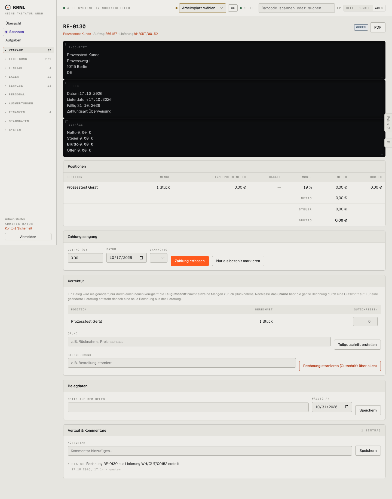

# 112-rechnung-offen — Rechnung offen

- **Bereich:** Verkauf
- **Route:** `/verkauf/rechnungen/3b91381c-6b95-4b9a-b1e2-b2e982454714`
- **Note:** 3 / 5
- **Zweck:** Offene Rechnung: Zahlung erfassen, korrigieren, PDF
- **Messwerte:** HTTP 200 · Ladezeit 809 ms · Seitenhöhe 1831 px · horizontaler Überlauf nein · Texte < 11 px: 41

## Was gut ist

- Grundsatz ‚Beleg wird nie geändert, nur korrigiert‘ wird erklärt
- Teilgutschrift je Position möglich
- Herkunft (Auftrag, Lieferung) verlinkt

## Befunde

| Schwere | Kategorie | Befund | Vorschlag |
|---|---|---|---|
| **hoch** | Layout | Anschrift, Belegdaten und Beträge als drei volle schwarze Balken untereinander (~430 px) – das wirkt wie ein Terminal, nicht wie eine Rechnung, und drückt Positionen nach unten. | Rechnungskopf als helle 3-Spalten-Karte (Anschrift / Belegdaten / Beträge) wie auf dem PDF. |
| **hoch** | Eingabe | Zahlungsbetrag als ‚0.00‘ mit Dezimalpunkt, Datum als 10/17/2026 – englische Formate in einem deutschen Finanzformular. | Zahlenfeld mit deutschem Format (Komma) und Datumsfeld TT.MM.JJJJ. |
| **mittel** | Logik | Nullrechnung (0,00 €) bietet ‚Zahlung erfassen‘, Teilgutschrift und Storno an. | Bei 0 € nur ‚als erledigt markieren‘. |
| **mittel** | Layout | Drei Formulare (Zahlung, Teilgutschrift, Storno) und Belegdaten stehen gleichzeitig offen – sehr lange Seite, Gefahr Fehlklick. | Aktionen als Knöpfe im Kopf, Formulare als Dialog/Schublade. |
| **niedrig** | Funktion | Bankkonto-Auswahl leer (‚—‘), ohne Hinweis, wo Konten gepflegt werden. | Leerzustand ‚Kein Bankkonto – in Einstellungen → Finanzen anlegen‘. |

[← zur Übersicht](../README.md)
