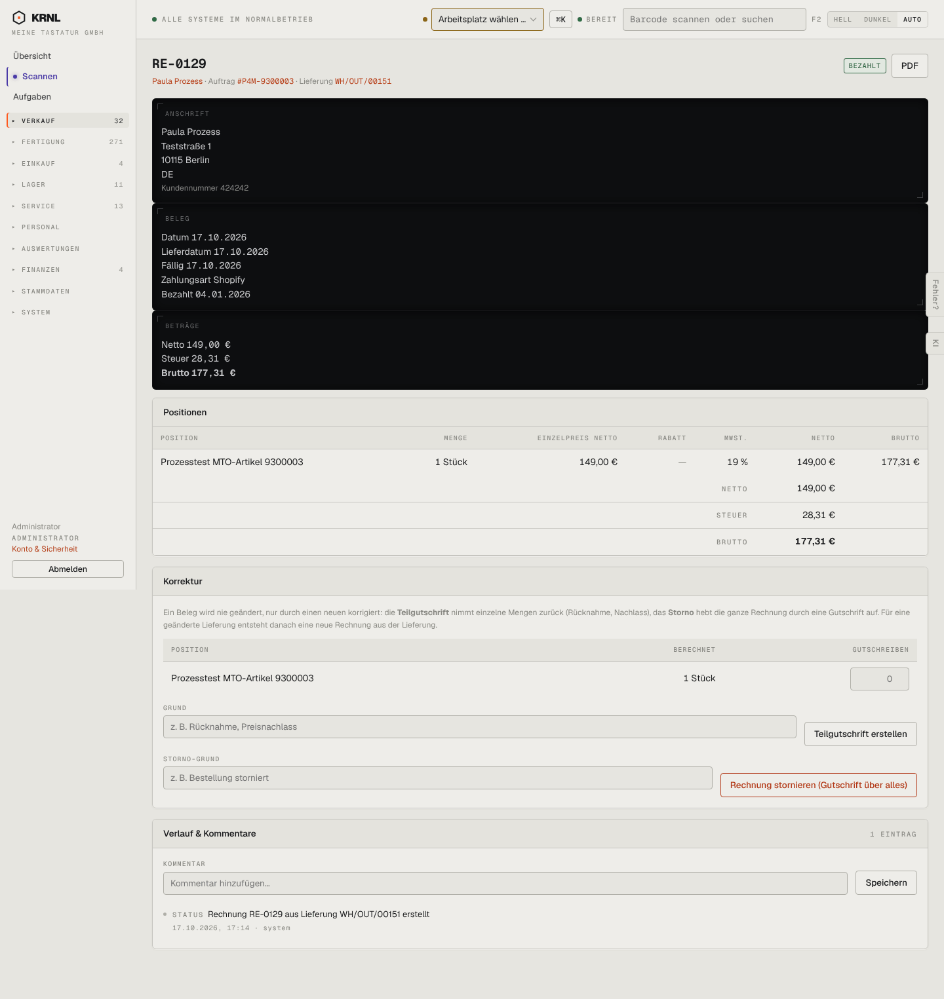

# 113-rechnung-bezahlt — Rechnung bezahlt

- **Bereich:** Verkauf
- **Route:** `/verkauf/rechnungen/c4dd6c57-804e-467b-801a-ac54be55d55e`
- **Note:** 3 / 5
- **Zweck:** Bezahlte Shop-Rechnung ansehen
- **Messwerte:** HTTP 200 · Ladezeit 739 ms · Seitenhöhe 1525 px · horizontaler Überlauf nein · Texte < 11 px: 36

## Was gut ist

- Status ‚BEZAHLT‘ grün, Bezahldatum sichtbar
- Kundennummer in der Anschrift

## Befunde

| Schwere | Kategorie | Befund | Vorschlag |
|---|---|---|---|
| **hoch** | Logik | Für eine über Shopify bezahlte Rechnung bietet KRNL Teilgutschrift und Storno an. Laut Betreiber bleiben Erstattungen in Shopify – eine Gutschrift hier erzeugt eine zweite, abweichende Wahrheit. | Bei Zahlungsart Shopify Korrekturen sperren (‚Erstattung im Shopify-Admin; Gutschrift folgt automatisch‘). |
| **niedrig** | Daten | ‚Fällig 17.10.2026‘ bei bereits am 04.01.2026 bezahlter Rechnung – Fälligkeit ist irrelevant, Bezahldatum liegt vor dem Rechnungsdatum. | Fälligkeit bei Vorkasse ausblenden; ‚Vorkasse (Shop) am 04.01.2026‘. |
| **niedrig** | Layout | Gleiche schwarze Balken wie 112. | Siehe 112. |

[← zur Übersicht](../README.md)
