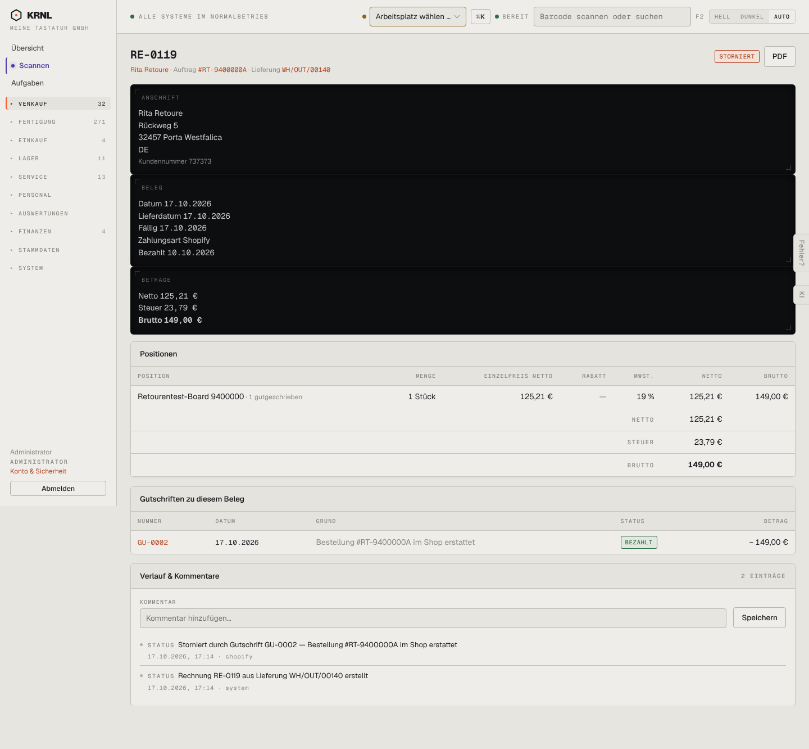

# 114-rechnung-storniert — Rechnung storniert

- **Bereich:** Verkauf
- **Route:** `/verkauf/rechnungen/bd7aed67-d564-4874-8fe1-7b9f0e2d6bd7`
- **Note:** 4 / 5
- **Zweck:** Stornierte Rechnung mit zugehöriger Gutschrift
- **Messwerte:** HTTP 200 · Ladezeit 736 ms · Seitenhöhe 1332 px · horizontaler Überlauf nein · Texte < 11 px: 39

## Was gut ist

- Gutschrift direkt verlinkt mit Grund
- Position zeigt ‚1 gutgeschrieben‘
- Keine Korrekturformulare mehr – richtig gesperrt

## Befunde

| Schwere | Kategorie | Befund | Vorschlag |
|---|---|---|---|
| **niedrig** | Status | Beträge-Block zeigt weiterhin Brutto 149,00 € ohne Hinweis, dass der Saldo 0 ist. | Zeile ‚Saldo nach Gutschrift: 0,00 €‘. |
| **niedrig** | Layout | Schwarze Kopfbalken wie 112. | Siehe 112. |

[← zur Übersicht](../README.md)
