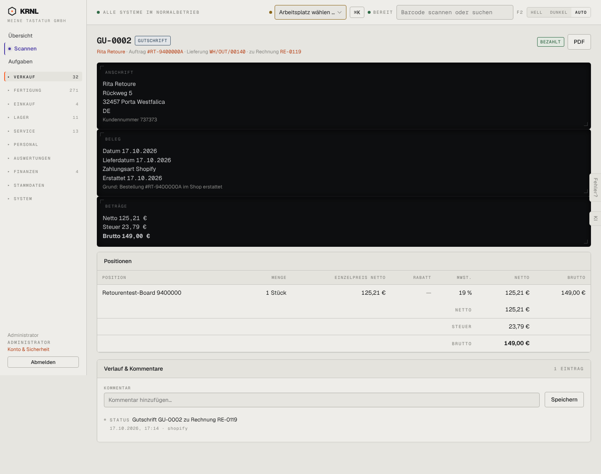

# 115-gutschrift — Gutschrift

- **Bereich:** Verkauf
- **Route:** `/verkauf/rechnungen/37c43ba0-0427-4451-a1d4-1b741f36f201`
- **Note:** 3 / 5
- **Zweck:** Gutschrift ansehen
- **Messwerte:** HTTP 200 · Ladezeit 796 ms · Seitenhöhe 1137 px · horizontaler Überlauf nein · Texte < 11 px: 32

## Was gut ist

- Bezug zu Rechnung, Auftrag, Lieferung im Untertitel
- Grund der Gutschrift sichtbar

## Befunde

| Schwere | Kategorie | Befund | Vorschlag |
|---|---|---|---|
| **mittel** | Konsistenz | In der Liste steht die Gutschrift mit −149,00 €, auf der Gutschrift selbst mit +149,00 € (Netto/Brutto positiv). | Vorzeichen einheitlich (auf dem Beleg ‚Gutschriftbetrag 149,00 €‘ klar beschriften, in Listen negativ). |
| **mittel** | Status | Status ‚BEZAHLT‘ für eine Gutschrift – gemeint ist ‚erstattet/ausgeglichen‘. | Statusbegriffe je Belegart: Gutschrift → ‚erstattet‘. |
| **niedrig** | Konsistenz | Belegart-Etikett ‚GUTSCHRIFT‘ links am Titel, Status-Etikett rechts – zwei Etiketten an verschiedenen Stellen. | Belegart im Titel (‚Gutschrift GU-0002‘), Status rechts. |

[← zur Übersicht](../README.md)
