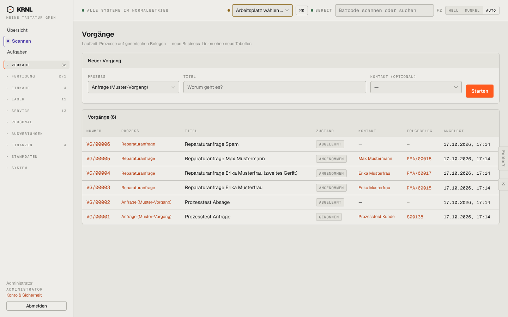

# 120-vorgaenge — Vorgänge

- **Bereich:** Verkauf
- **Route:** `/vorgaenge`
- **Note:** 3 / 5
- **Zweck:** Alle Laufzeit-Vorgänge (generische Prozesse) sehen und neuen starten
- **Messwerte:** HTTP 200 · Ladezeit 845 ms · Seitenhöhe 900 px · horizontaler Überlauf nein · Texte < 11 px: 29

## Was gut ist

- Folgebeleg (RMA, Auftrag) direkt verlinkt
- Neuer Vorgang mit Prozessauswahl in einer Zeile

## Befunde

| Schwere | Kategorie | Befund | Vorschlag |
|---|---|---|---|
| **hoch** | Texte | Untertitel „Laufzeit-Prozesse auf generischen Belegen — neue Business-Linien ohne neue Tabellen“ ist Entwicklersprache; ein Anwender versteht nicht, wofür die Seite da ist. | Nutzersprache: ‚Anfragen und andere Abläufe, die keinen eigenen Menüpunkt haben‘. |
| **mittel** | Status | Alle Zustände (abgelehnt, angenommen, gewonnen) im gleichen grauen Etikett – Erfolg und Absage nicht unterscheidbar. | Semantische Farben: gewonnen/angenommen grün, abgelehnt/verloren neutral-rot, offen blau. |
| **mittel** | Filter | Keine Filter (offen/erledigt, Prozess) und keine Suche; erledigte und offene Vorgänge gemischt. | Standardfilter ‚offen‘, Chips je Prozess. |
| **niedrig** | Navigation | Unklar, warum Reparaturanfragen hier und zusätzlich unter Service erscheinen. | Querverweis oder Erklärung ‚Reparaturanfragen werden hier vorgeprüft und unter Service bearbeitet‘. |

[← zur Übersicht](../README.md)
