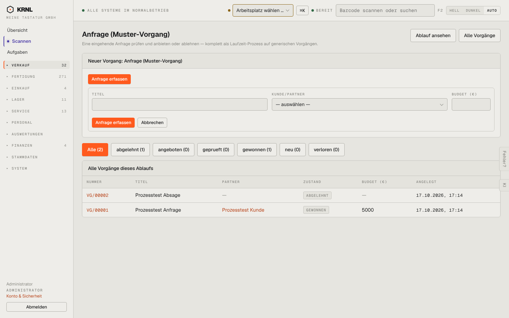

# 121-vorgaenge-anfrage — Vorgänge: Anfragen

- **Bereich:** Verkauf
- **Route:** `/vorgaenge/prozess/anfrage`
- **Note:** 3 / 5
- **Zweck:** Vorgänge eines Prozesses (Anfrage) filtern und neu erfassen
- **Messwerte:** HTTP 200 · Ladezeit 786 ms · Seitenhöhe 900 px · horizontaler Überlauf nein · Texte < 11 px: 24

## Was gut ist

- Zustandsfilter mit Zählern
- Link ‚Ablauf ansehen‘ zum Prozessdiagramm

## Befunde

| Schwere | Kategorie | Befund | Vorschlag |
|---|---|---|---|
| **mittel** | Konsistenz | Zwei orange Knöpfe ‚Anfrage erfassen‘ übereinander (Aufklapper und Absenden) – doppelt und verwirrend. | Oberer Knopf öffnet ein Formular/Dialog; nur ein Primärknopf sichtbar. |
| **mittel** | Filter | Zustandsfilter alphabetisch (abgelehnt, angeboten, geprueft, gewonnen, neu, verloren) statt in Prozessreihenfolge; ‚geprueft‘ ohne Umlaut, alles kleingeschrieben. | Reihenfolge des Ablaufs (neu → geprüft → angeboten → gewonnen/verloren/abgelehnt), Anzeige-Labels mit Umlauten. |
| **niedrig** | Typografie | Budget ‚5000‘ ohne Tausenderpunkt/Währung in der Tabelle. | ‚5.000 €‘. |

[← zur Übersicht](../README.md)
