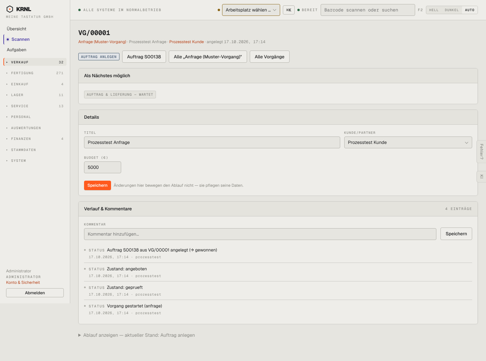

# 122-vorgang-anfrage-gewonnen — Anfrage gewonnen

- **Bereich:** Verkauf
- **Route:** `/vorgaenge/71db7ae8-004e-4502-8a96-44e4647821ff`
- **Note:** 2 / 5
- **Zweck:** Gewonnene Anfrage mit Folgeauftrag
- **Messwerte:** HTTP 200 · Ladezeit 1012 ms · Seitenhöhe 1071 px · horizontaler Überlauf nein · Texte < 11 px: 48

## Was gut ist

- Folgeauftrag S00138 als Knopf
- Hinweis ‚Änderungen hier bewegen den Ablauf nicht‘
- Verlauf zeigt Zustandswechsel

## Befunde

| Schwere | Kategorie | Befund | Vorschlag |
|---|---|---|---|
| **hoch** | Status | Kopfetikett zeigt den Schrittnamen ‚AUFTRAG ANLEGEN‘ (klingt wie ein Knopf), der Zustand ist laut Liste ‚gewonnen‘. ‚Als Nächstes möglich: AUFTRAG & LIEFERUNG – WARTET‘ ist unverständlich. | Kopf zeigt Zustand (‚Gewonnen‘), Stepper zeigt Schritte; ‚Als Nächstes‘ als Klartext (‚Wartet auf Lieferung von S00138‘). |
| **mittel** | Layout | Ablaufdiagramm ist unten eingeklappt (‚Ablauf anzeigen — aktueller Stand …‘) – die wichtigste Orientierung ist versteckt. | Kompakten Stepper immer oben zeigen, Diagramm optional. |
| **niedrig** | Texte | Verlauf ‚Zustand: geprueft‘ ohne Umlaut, ‚Vorgang gestartet (anfrage)‘ mit technischem Code. | Anzeigenamen statt Codes. |

[← zur Übersicht](../README.md)
