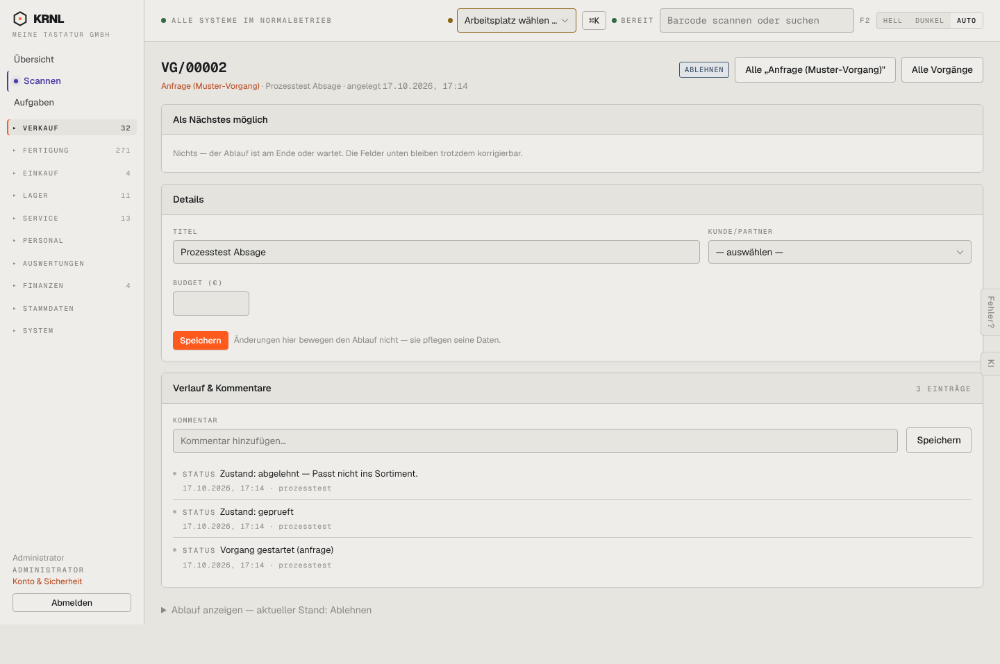

# 123-vorgang-anfrage-abgelehnt — Anfrage abgelehnt

- **Bereich:** Verkauf
- **Route:** `/vorgaenge/ab7c041b-1931-4c21-8d3e-6cf8b1220eb0`
- **Note:** 2 / 5
- **Zweck:** Abgelehnte Anfrage
- **Messwerte:** HTTP 200 · Ladezeit 843 ms · Seitenhöhe 957 px · horizontaler Überlauf nein · Texte < 11 px: 45

## Was gut ist

- Begründung steht im Verlauf

## Befunde

| Schwere | Kategorie | Befund | Vorschlag |
|---|---|---|---|
| **hoch** | Status | Kopfetikett ‚ABLEHNEN‘ (Verb/Schrittname) statt Zustand ‚Abgelehnt‘ – liest sich wie ein Knopf zum Ablehnen. | Zustand als Partizip, Schrittnamen nur im Stepper. |
| **mittel** | Texte | ‚Nichts — der Ablauf ist am Ende oder wartet‘ – der Nutzer erfährt nicht, welches von beiden. | Unterscheiden: ‚Abgeschlossen (abgelehnt)‘ vs. ‚Wartet auf …‘. |
| **niedrig** | Daten | Ablehnungsgrund nur im Verlauf, nicht in den Details. | Grund als Feld/Hinweisbox oben. |

[← zur Übersicht](../README.md)
