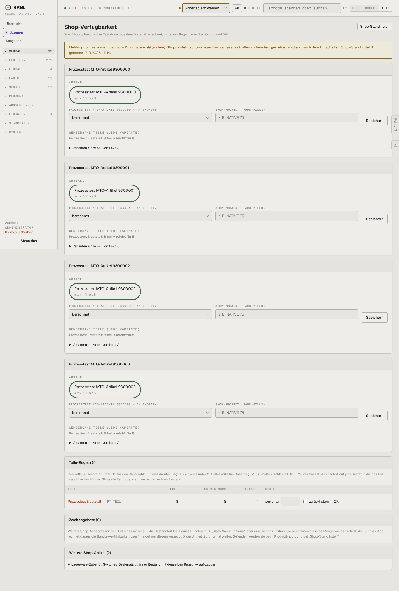

# 130-shop-verfuegbarkeit — Shop-Verfügbarkeit

- **Bereich:** Verkauf
- **Route:** `/verkauf/shop-verfuegbarkeit`
- **Note:** 2 / 5
- **Zweck:** Steuern, welche Mengen an Shopify gemeldet werden (baubar aus Material, Regeln je Teil)
- **Messwerte:** HTTP 200 · Ladezeit 792 ms · Seitenhöhe 2133 px · horizontaler Überlauf nein · Texte < 11 px: 63

## Was gut ist

- Klarer Hinweis, dass Shopify auf ‚nur lesen‘ steht
- Engpass je Teil sichtbar (‚8 frei → reicht für 8‘)
- Teile-Regeln mit verständlicher Erklärung (Blue-Case-Beispiel)

## Befunde

| Schwere | Kategorie | Befund | Vorschlag |
|---|---|---|---|
| **hoch** | Layout | Jeder Artikel ist eine ~350 px hohe Karte; die eigentliche Antwort ‚wie viel geht an Shopify‘ steht klein als ‚bis 6‘ in einer grün umrandeten Ellipse. Bei vielen Artikeln endlos scrollen. | Übersichtstabelle: Artikel / Varianten / baubar / an Shopify (groß) / Engpassteil / Regel; Details aufklappbar. |
| **mittel** | Texte | Banner ‚Meldung für Tastaturen: baubar − 2, höchstens 99 (ändern)‘ ist kryptisch. | ‚Wir melden: baubare Menge minus 2 Sicherheitspuffer, höchstens 99 Stück‘. |
| **mittel** | Konsistenz | Feldlabel wiederholt den Artikelnamen in Versalien (‚PROZESSTEST MTO-ARTIKEL 9300000 — AN SHOPIFY‘) direkt unter dem gleichen Kartentitel; je Karte eigener Speichern-Knopf. | Label ‚Meldung an Shopify‘; gesammeltes Speichern oder Autosave. |
| **niedrig** | Eingabe | Teile-Regel: leeres Feld ‚aus unter [ ]‘ ohne Platzhalter, Knopf ‚OK‘ generisch. | Platzhalter ‚z. B. 2‘, Knopf ‚Regel speichern‘. |
| **niedrig** | Navigation | Seite liegt unter Verkauf, betrifft aber Lager/Material und Shop-Anbindung. | Auch aus Lager → Bestand und Einstellungen → Anbindungen verlinken. |

[← zur Übersicht](../README.md)
