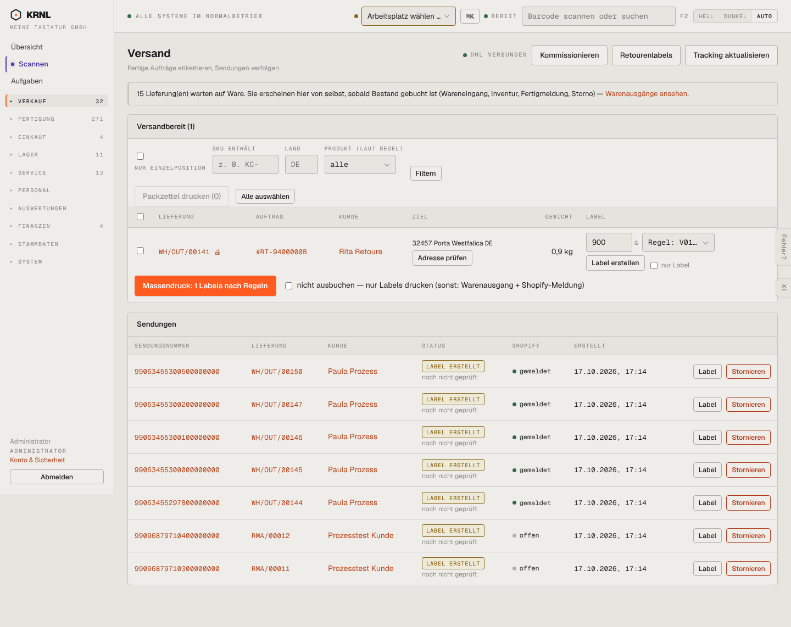

# 200-versand — Versand

- **Bereich:** Versand & Retouren
- **Route:** `/versand`
- **Note:** 3 / 5
- **Zweck:** Versandbereite Lieferungen etikettieren (einzeln/Massendruck), Sendungen verfolgen
- **Messwerte:** HTTP 200 · Ladezeit 867 ms · Seitenhöhe 1142 px · horizontaler Überlauf nein · Texte < 11 px: 37

## Was gut ist

- Hinweisbanner erklärt, warum 15 Lieferungen fehlen (warten auf Ware) mit Link
- Massendruck nach Regeln mit Option ‚nur Labels‘
- Shopify-Meldestatus je Sendung sichtbar
- DHL-Verbindungsstatus im Kopf

## Befunde

| Schwere | Kategorie | Befund | Vorschlag |
|---|---|---|---|
| **hoch** | Layout | Filterzeile der Versandbereit-Karte ist unaufgeräumt: Checkbox ‚Nur Einzelposition‘ steht mit Label darunter, Felder unterschiedlich breit, ‚Filtern‘-Knopf tiefer als die Felder; ‚Packzettel drucken (0)‘ wirkt deaktiviert und steht neben ‚Alle auswählen‘. | Filter als einheitliche Chip-/Feldleiste auf einer Grundlinie, Sofortfilter ohne Knopf; Auswahlaktionen erst bei Auswahl einblenden (Aktionsleiste). |
| **mittel** | Eingabe | Pro Zeile Gewicht ‚900 g‘, Regel-Auswahl ‚Regel: V01…‘ (abgeschnitten), ‚Label erstellen‘ und Checkbox ‚nur Label‘ – vier Bedienelemente in einer Zelle; Gewicht in g, Spalte ‚Gewicht‘ daneben in kg (0,9 kg). | Gewicht einmal (kg), Regel als Text mit Ändern-Link, ein Knopf ‚Label‘ mit Menü für Optionen. |
| **mittel** | Status | Alle Sendungen ‚LABEL ERSTELLT – noch nicht geprüft‘ (gelb) – unklar, was ‚geprüft‘ heißt (Tracking abgefragt?) und ob Handlungsbedarf besteht. | Tracking-Status in Klartext (‚bei DHL noch nicht eingegangen‘, ‚unterwegs‘, ‚zugestellt‘) mit Zeitpunkt der letzten Abfrage. |
| **mittel** | Konsistenz | ‚Stornieren‘ rot neben jeder Sendung – destruktive Aktion in jeder Zeile prominent. | Ins Zeilenmenü (⋯). |
| **niedrig** | Daten | Sendungen-Liste mischt Kundenlieferungen und RMA-Rücksendungen (Spalte Lieferung: WH/OUT/… vs. RMA/…) ohne Kennzeichnung; Shopify ‚offen‘ bei RMA ist irreführend (gar nicht meldepflichtig). | Typ-Spalte (Auftrag/Reparatur) und Shopify-Spalte bei Nicht-Shop ‚—‘. |
| **niedrig** | Leistung | Keine Seitenaufteilung/Zeitraum für Sendungen; wächst unbegrenzt. | Zeitraumfilter (letzte 14 Tage) + Suche nach Sendungsnummer. |

[← zur Übersicht](../README.md)
