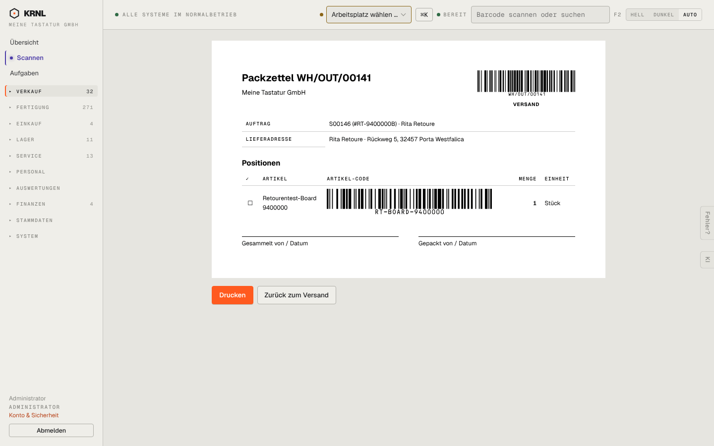

# 201-packzettel — Packzettel

- **Bereich:** Versand & Retouren
- **Route:** `/versand/packzettel?ids=965d2049-9eac-4716-af8a-d0bbd9101dc1`
- **Note:** 4 / 5
- **Zweck:** Sammeldruck Packzettel (mit Auswahl ?ids=)
- **Messwerte:** HTTP 200 · Ladezeit 746 ms · Seitenhöhe 900 px · horizontaler Überlauf nein · Texte < 11 px: 20

## Was gut ist

- Saubere Druckansicht mit Barcode für Lieferung und Artikel
- Abhak-Kästchen je Position, Unterschriftsfelder ‚Gesammelt/Gepackt von‘
- Knöpfe ‚Drucken‘ und ‚Zurück zum Versand‘

## Befunde

| Schwere | Kategorie | Befund | Vorschlag |
|---|---|---|---|
| **mittel** | Daten | Kein Lagerplatz je Position und keine Versandart/Kundennotiz auf dem Packzettel. | Spalten Lagerplatz, Hinweis-Box für Kundennotiz/Geschenk. |
| **niedrig** | Layout | Artikel-Barcode ist sehr breit (größer als der Belegbarcode) und drängt Artikelnamen in zwei Zeilen. | Barcode kompakter (feste Breite), Name eine Zeile. |

[← zur Übersicht](../README.md)
