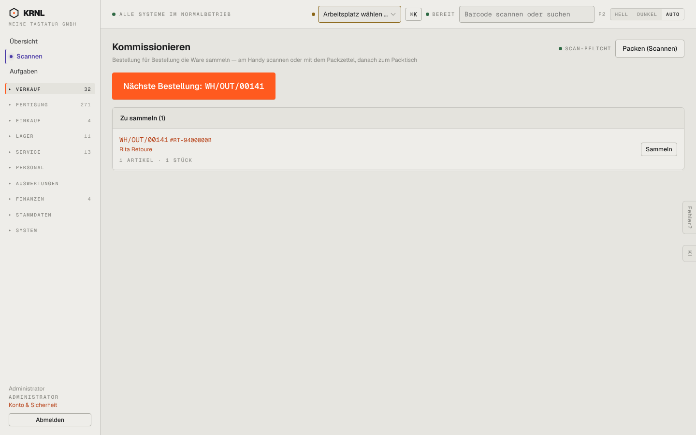

# 202-kommissionieren — Kommissionieren

- **Bereich:** Versand & Retouren
- **Route:** `/kommissionieren`
- **Note:** 4 / 5
- **Zweck:** Nächste Bestellung zum Sammeln wählen
- **Messwerte:** HTTP 200 · Ladezeit 816 ms · Seitenhöhe 900 px · horizontaler Überlauf nein · Texte < 11 px: 14

## Was gut ist

- Riesiger Primärknopf ‚Nächste Bestellung‘ – ideal für Lager
- Status ‚Scan-Pflicht‘ sichtbar
- Kompakte Liste mit Artikel/Stück

## Befunde

| Schwere | Kategorie | Befund | Vorschlag |
|---|---|---|---|
| **niedrig** | Konsistenz | Knopf ‚Packen (Scannen)‘ führt zur Seite ‚Scannen‘ – Menüpunkt heißt ‚Scannen‘, Route /scanner, Begriff ‚Packtisch‘ in der Doku: drei Namen für dieselbe Station. | Einheitlich ‚Packtisch‘ oder ‚Scannen‘. |
| **niedrig** | Layout | Viel Leerraum; bei einer Bestellung wirkt die Seite leer, Priorität/Versandart/Alter der Bestellung fehlen. | Spalten ‚bestellt vor‘, Versandart, Priorität. |

[← zur Übersicht](../README.md)
