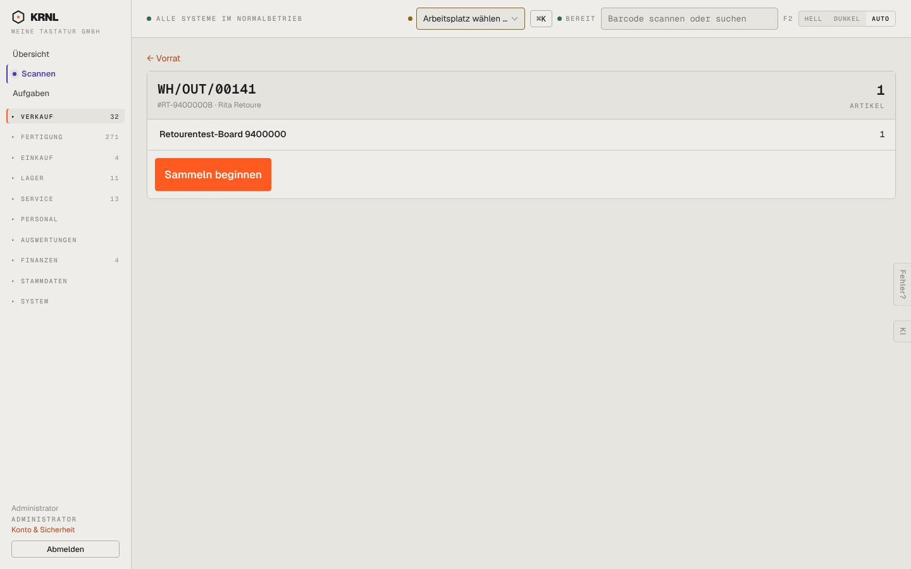

# 203-kommissionieren-beleg — Kommissionieren: Lieferung

- **Bereich:** Versand & Retouren
- **Route:** `/kommissionieren/965d2049-9eac-4716-af8a-d0bbd9101dc1`
- **Note:** 4 / 5
- **Zweck:** Einzelne Lieferung sammeln
- **Messwerte:** HTTP 200 · Ladezeit 760 ms · Seitenhöhe 900 px · horizontaler Überlauf nein · Texte < 11 px: 14

## Was gut ist

- Großer Startknopf, klare Positionsliste
- Zurück-Link oben

## Befunde

| Schwere | Kategorie | Befund | Vorschlag |
|---|---|---|---|
| **mittel** | Texte | Zurück-Link heißt ‚Vorrat‘ – gemeint ist die Kommissionierliste. | ‚← Zur Kommissionierliste‘. |
| **niedrig** | Daten | Kein Lagerplatz je Position – beim Sammeln die wichtigste Information. | Lagerplatz/Fach je Position, sortiert nach Laufweg. |

[← zur Übersicht](../README.md)
