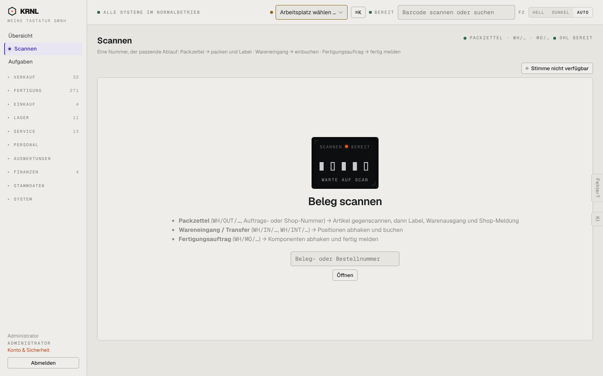

# 204-packtisch — Packtisch

- **Bereich:** Versand & Retouren
- **Route:** `/packtisch`
- **Note:** 3 / 5
- **Zweck:** Scan-Station (Packtisch): Beleg scannen → passender Ablauf
- **Messwerte:** HTTP 200 · Ladezeit 802 ms · Seitenhöhe 900 px · horizontaler Überlauf nein · Texte < 11 px: 17

## Was gut ist

- Klare Erklärung, welche Nummern welchen Ablauf auslösen
- Scanner-Bereitschaftsanzeige

## Befunde

| Schwere | Kategorie | Befund | Vorschlag |
|---|---|---|---|
| **mittel** | Konsistenz | Identisch mit 012-scanner (gleiche Route); Statuszeile oben rechts ‚PACKZETTEL · WH/… · MO/… ● DHL BEREIT‘ ist abgeschnitten. | Statuszeile ausschreiben oder als Chips. |
| **niedrig** | Funktion | ‚Stimme nicht verfügbar‘ als grauer Knopf ohne Erklärung, was fehlt. | Tooltip/Hinweis ‚Sprachansage braucht Einstellung X‘. |

[← zur Übersicht](../README.md)
