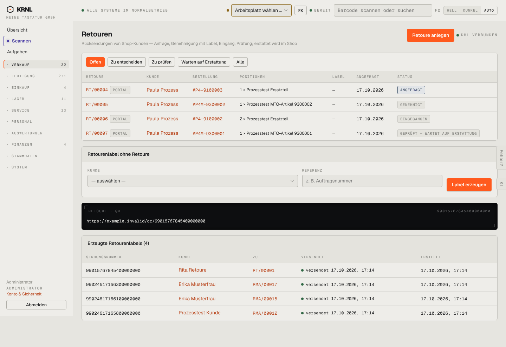

# 210-retouren — Retouren (offen)

- **Bereich:** Versand & Retouren
- **Route:** `/versand/retouren`
- **Note:** 3 / 5
- **Zweck:** Offene Kunden-Retouren steuern, Retourenlabel ohne Retoure erzeugen
- **Messwerte:** HTTP 200 · Ladezeit 882 ms · Seitenhöhe 989 px · horizontaler Überlauf nein · Texte < 11 px: 36

## Was gut ist

- Filter-Chips nach Arbeitsschritt (Zu entscheiden, Zu prüfen, Warten auf Erstattung)
- Kennzeichnung ‚PORTAL‘ für Portalanfragen
- Positionen direkt in der Liste

## Befunde

| Schwere | Kategorie | Befund | Vorschlag |
|---|---|---|---|
| **mittel** | Status | Nur ‚ANGEFRAGT‘ ist farbig (blau); ‚EINGEGANGEN‘ (= zu prüfen, Handlungsbedarf) und ‚GENEHMIGT‘ sind grau wie erledigte Zustände. | Farbe nach Handlungsbedarf: zu entscheiden/zu prüfen = Akzent, wartend = neutral, abgeschlossen = grün. |
| **mittel** | Layout | Schwarzer Block ‚RETOURE · QR https://example.invalid/qr/…‘ steht dauerhaft zwischen Formular und Labelliste – zeigt das zuletzt erzeugte Label wie eine Debug-Ausgabe. | QR nur direkt nach dem Erzeugen als Erfolgsmeldung/Dialog, sonst in der Labelzeile. |
| **mittel** | Konsistenz | Zwei orange Primärknöpfe (‚Retoure anlegen‘, ‚Label erzeugen‘); ‚Retourenlabel ohne Retoure‘ (Sonderfall) steht prominent vor der Labelliste. | Sonderfall einklappen; ein Primärknopf je Seite. |
| **niedrig** | Daten | Spalte ‚Label‘ zeigt ‚—‘ auch bei der genehmigten RT/00005 – ob das Label fehlt oder nicht nötig war, ist unklar; Grund der Retoure fehlt als Spalte. | Label-Zustand (‚fehlt!‘ rot bei genehmigt) und Spalte Grund. |

[← zur Übersicht](../README.md)
