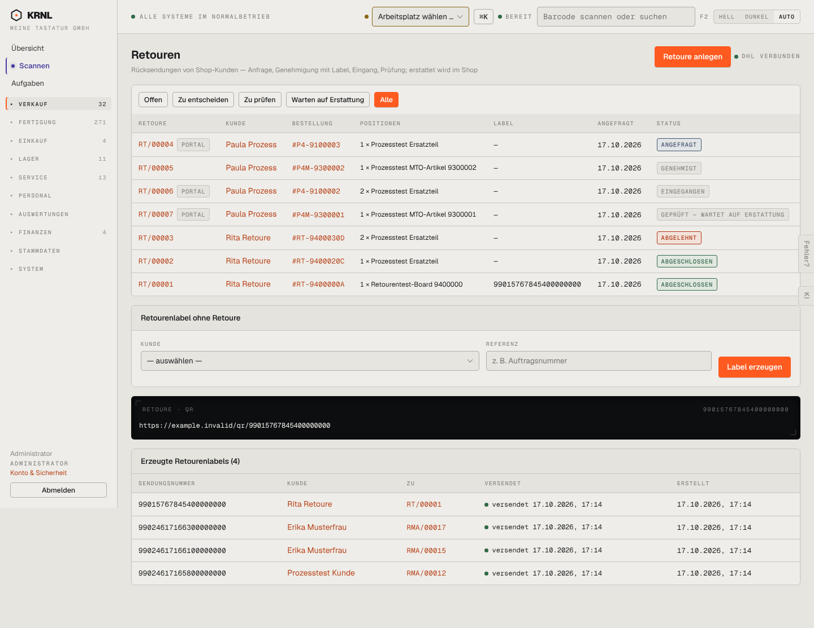

# 211-retouren-alle — Retouren (alle)

- **Bereich:** Versand & Retouren
- **Route:** `/versand/retouren?filter=alle`
- **Note:** 3 / 5
- **Zweck:** Alle Retouren inkl. abgeschlossener/abgelehnter
- **Messwerte:** HTTP 200 · Ladezeit 912 ms · Seitenhöhe 1113 px · horizontaler Überlauf nein · Texte < 11 px: 39

## Was gut ist

- Abgeschlossen grün, abgelehnt rot – hier semantisch richtig

## Befunde

| Schwere | Kategorie | Befund | Vorschlag |
|---|---|---|---|
| **niedrig** | Leistung | Keine Suche/Seitenaufteilung – bei wachsender Zahl nicht mehr nutzbar. | Suche nach Retouren-/Bestellnummer, Kunde; Seitenaufteilung. |
| **niedrig** | Status | ‚GEPRÜFT – WARTET AUF ERSTATTUNG‘ als sehr langes Etikett sprengt die Spalte. | Kurz ‚Wartet auf Erstattung‘. |

[← zur Übersicht](../README.md)
