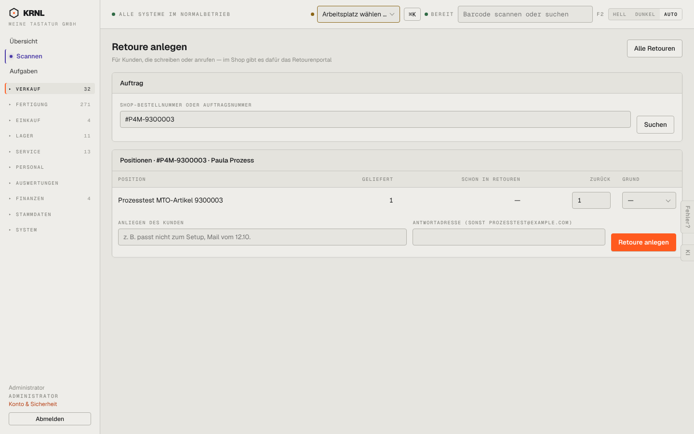

# 212-retoure-neu — Retoure anlegen

- **Bereich:** Versand & Retouren
- **Route:** `/versand/retouren/neu?auftrag=bc4fecaf-459c-474c-bd95-4abb395ecf09`
- **Note:** 4 / 5
- **Zweck:** Retoure von Hand für einen Shop-Auftrag anlegen
- **Messwerte:** HTTP 200 · Ladezeit 768 ms · Seitenhöhe 900 px · horizontaler Überlauf nein · Texte < 11 px: 21

## Was gut ist

- Suche nach Shop- oder Auftragsnummer, Positionen mit geliefert/schon in Retouren
- Menge bei Einzelposition vorbelegt
- Antwortadresse mit Rückfall auf Bestelladresse

## Befunde

| Schwere | Kategorie | Befund | Vorschlag |
|---|---|---|---|
| **niedrig** | Typografie | Feldlabel in Versalien enthält die E-Mail-Adresse (‚ANTWORTADRESSE (SONST PROZESSTEST@EXAMPLE.COM)‘) – Adresse in Großbuchstaben schwer lesbar. | Adresse als Platzhalter im Feld statt im Label. |
| **niedrig** | Eingabe | Grund-Auswahl ist schmal (‚—‘), Pflicht/optional nicht erkennbar. | Breitere Auswahl, Kennzeichnung optional/Pflicht. |

[← zur Übersicht](../README.md)
