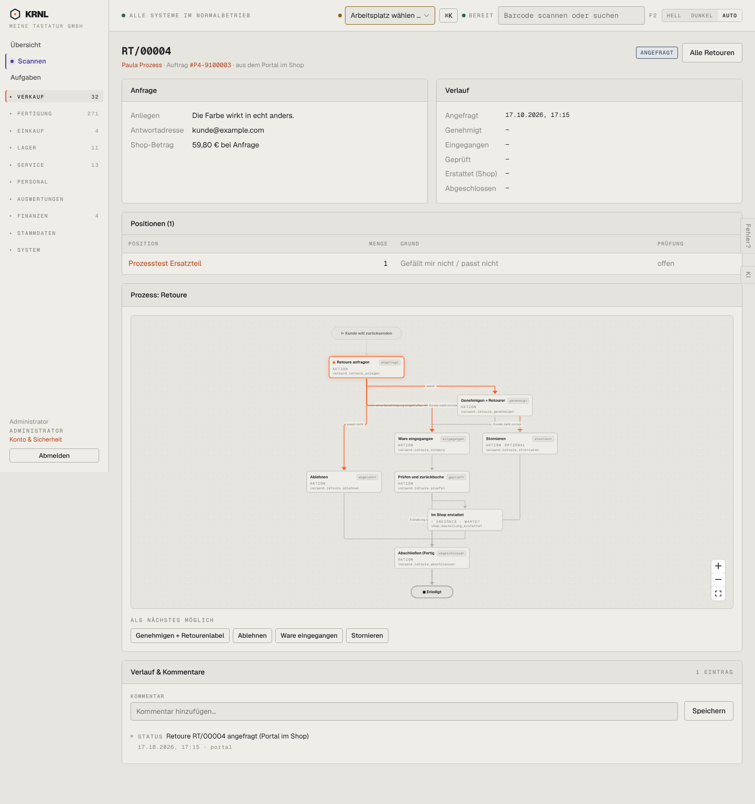

# 213-retoure-angefragt — Retoure angefragt

- **Bereich:** Versand & Retouren
- **Route:** `/versand/retouren/39f611c8-b4c9-420d-8359-4f0169ce4878`
- **Note:** 3 / 5
- **Zweck:** Retouren-Anfrage entscheiden (genehmigen/ablehnen)
- **Messwerte:** HTTP 200 · Ladezeit 882 ms · Seitenhöhe 1533 px · horizontaler Überlauf nein · Texte < 11 px: 53

## Was gut ist

- Verlauf als Zeitleiste aller Schritte inkl. ‚Erstattet (Shop)‘
- Prozessdiagramm mit aktuellem Schritt markiert
- Anfrage kompakt (Anliegen, Adresse, Shop-Betrag)

## Befunde

| Schwere | Kategorie | Befund | Vorschlag |
|---|---|---|---|
| **hoch** | Schritte | Unter ‚Als Nächstes möglich‘ stehen vier gleichrangige graue Knöpfe (Genehmigen + Retourenlabel, Ablehnen, Ware eingegangen, Stornieren) – keine Primäraktion, der Normalfall (Genehmigen) ist nicht hervorgehoben. | Genehmigen als Primärknopf oben im Kopf, Ablehnen sekundär, Sonderwege (Eingang ohne Genehmigung, Stornieren) im Mehr-Menü. |
| **hoch** | Barrierefreiheit | Prozessdiagramm in Originalgröße unlesbar (Schrift ~7 px), Knotentitel abgeschnitten (‚Genehmigen + Retourer‘, ‚Prüfen und zurückbuche‘), technische Aktionsnamen (versand.retoure_anlegen) für Anwender sichtbar; nimmt ~600 px Höhe ein. | Kompakter horizontaler Stepper der Hauptschritte; Diagramm einklappbar; Codes nur im Designer. |
| **niedrig** | Layout | Karte ‚Anfrage‘ hat viel Leerraum, ‚Verlauf‘-Karte zeigt nur Striche für künftige Schritte. | Verlauf als Stepper, Anfrage daneben schmaler. |

[← zur Übersicht](../README.md)
