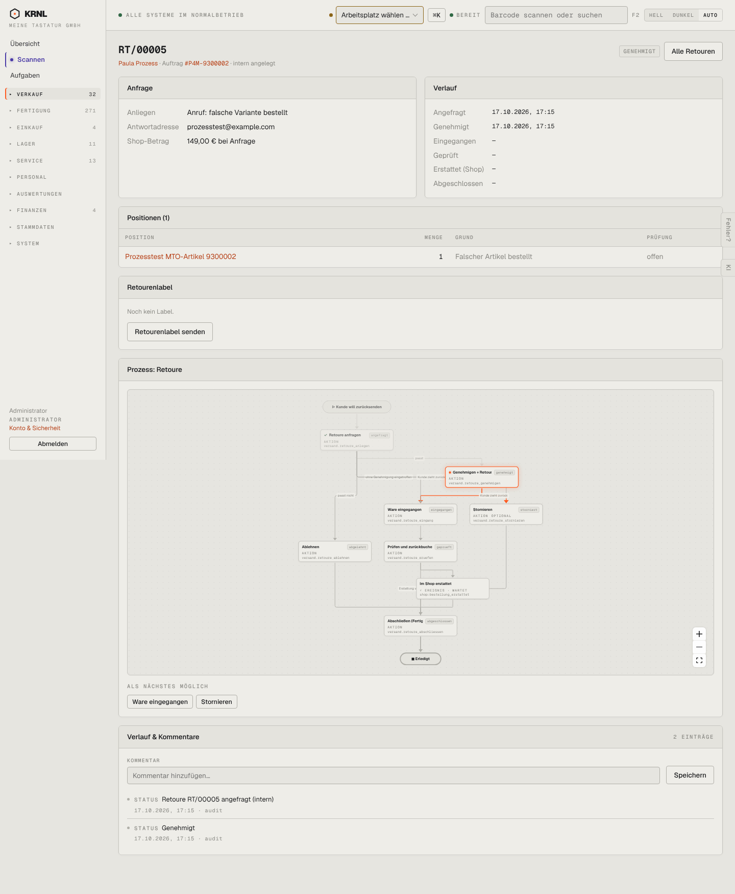

# 214-retoure-genehmigt — Retoure genehmigt

- **Bereich:** Versand & Retouren
- **Route:** `/versand/retouren/2e78eceb-0750-400d-9e9c-697bdace3bc8`
- **Note:** 3 / 5
- **Zweck:** Genehmigte Retoure – warten auf Paket
- **Messwerte:** HTTP 200 · Ladezeit 846 ms · Seitenhöhe 1750 px · horizontaler Überlauf nein · Texte < 11 px: 55

## Was gut ist

- Karte Retourenlabel mit ‚Retourenlabel senden‘

## Befunde

| Schwere | Kategorie | Befund | Vorschlag |
|---|---|---|---|
| **hoch** | Status | Genehmigt, aber ‚Noch kein Label.‘ ohne Grund – war der Schalter aus oder ist der DHL-Aufruf gescheitert? Der Kunde kann ohne Label nichts zurückschicken. | Deutlicher Hinweis (gelb) ‚Kunde hat noch kein Label – Grund: … – jetzt senden‘. |
| **niedrig** | Schritte | Diagramm wie 213; nächste Aktion ‚Ware eingegangen‘ wäre beim Paketeingang per Scan – der Hinweis ‚Retourennummer am Packtisch scannen‘ fehlt. | Hinweistext zum Scan-Eingang. |

[← zur Übersicht](../README.md)
