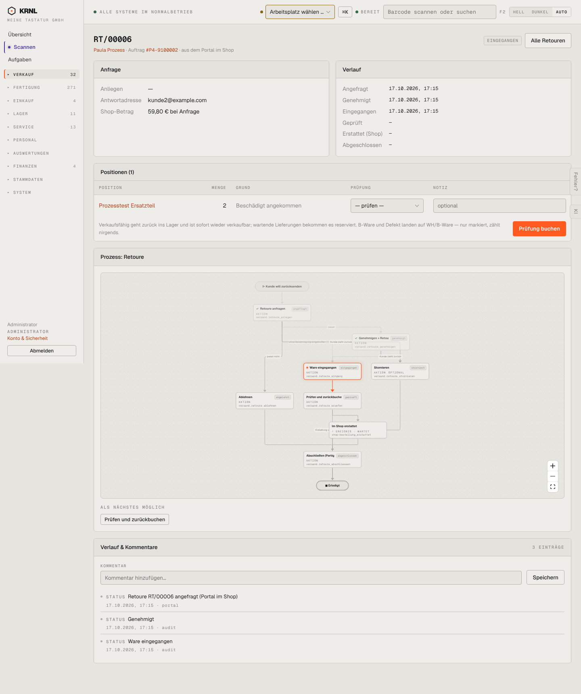

# 215-retoure-eingegangen — Retoure eingegangen (Prüfmaske)

- **Bereich:** Versand & Retouren
- **Route:** `/versand/retouren/c00cb487-bab9-43eb-a40e-c0b48a5965ce`
- **Note:** 3 / 5
- **Zweck:** Eingegangene Ware prüfen und zurückbuchen
- **Messwerte:** HTTP 200 · Ladezeit 822 ms · Seitenhöhe 1719 px · horizontaler Überlauf nein · Texte < 11 px: 58

## Was gut ist

- Prüfmaske direkt in den Positionen mit Notiz
- Klare Erklärung, wohin verkaufsfähig/B-Ware/defekt gebucht wird
- Primärknopf ‚Prüfung buchen‘

## Befunde

| Schwere | Kategorie | Befund | Vorschlag |
|---|---|---|---|
| **mittel** | Logik | Bei Menge 2 gibt es nur ein Prüfergebnis je Position – 1 verkaufsfähig + 1 defekt ist nicht abbildbar. | Ergebnis je Stück bzw. Mengenaufteilung je Ergebnis. |
| **mittel** | Konsistenz | Zwei Wege zur selben Aktion: ‚Prüfung buchen‘ in der Positionskarte und ‚Prüfen und zurückbuchen‘ unter ‚Als Nächstes möglich‘. | Nur einen Einstieg; Prozess-Panel verweist auf die Maske. |
| **niedrig** | Daten | Anliegen ‚—‘ (leer) – Portalanfrage ohne Text. | Leeres Feld ausblenden. |

[← zur Übersicht](../README.md)
