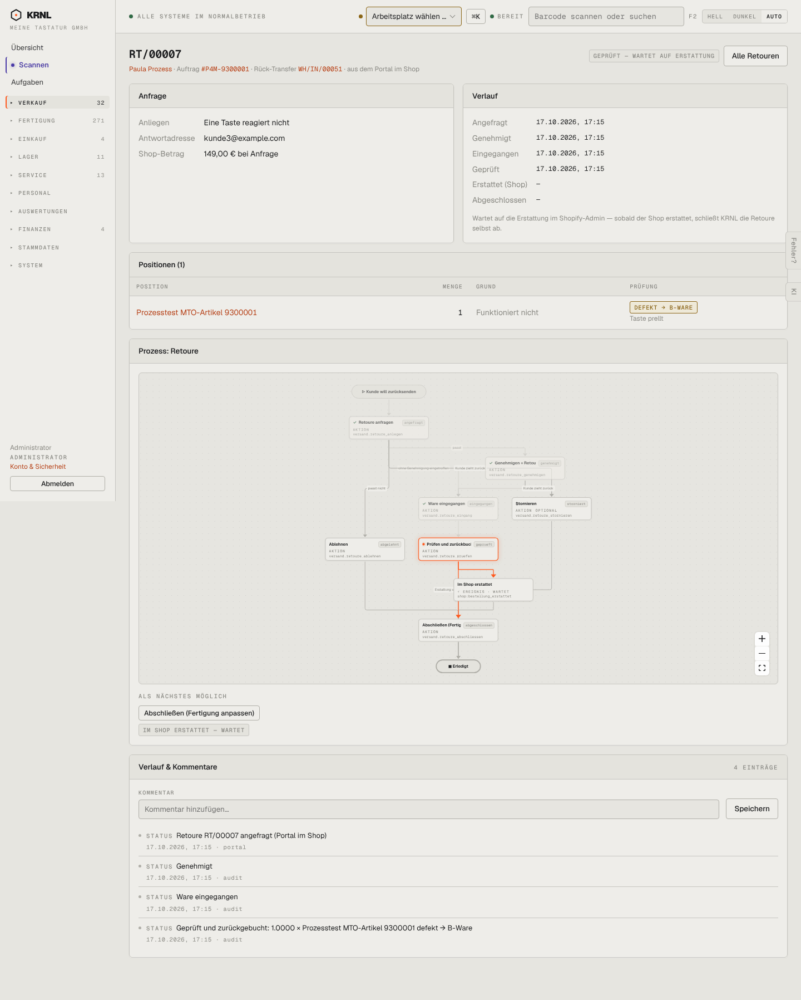

# 216-retoure-geprueft — Retoure geprüft

- **Bereich:** Versand & Retouren
- **Route:** `/versand/retouren/618ea911-e6a1-46bc-8066-f31626fd623a`
- **Note:** 3 / 5
- **Zweck:** Geprüfte Retoure wartet auf Shop-Erstattung
- **Messwerte:** HTTP 200 · Ladezeit 813 ms · Seitenhöhe 1796 px · horizontaler Überlauf nein · Texte < 11 px: 61

## Was gut ist

- Hinweis ‚Wartet auf die Erstattung im Shopify-Admin — KRNL schließt selbst ab‘
- Rück-Transfer WH/IN/00051 verlinkt
- Prüfergebnis mit Notiz (‚Taste prellt‘)

## Befunde

| Schwere | Kategorie | Befund | Vorschlag |
|---|---|---|---|
| **mittel** | Texte | Verlauf: ‚1.0000 × Prozesstest MTO-Artikel 9300001 defekt → B-Ware‘ – unformatierte Menge. | qty()-Formatierung. |
| **mittel** | Logik | Nächste Aktion ‚Abschließen (Fertigung anpassen)‘ auch bei reiner B-Ware/defekt, wo keine Fertigung betroffen ist. | Beschriftung je Fall (‚Abschließen (im Shop erstattet)‘). |
| **niedrig** | Status | Kein Link ‚In Shopify erstatten‘ zur Bestellung im Admin. | Direktlink zur Shopify-Bestellung. |

[← zur Übersicht](../README.md)
