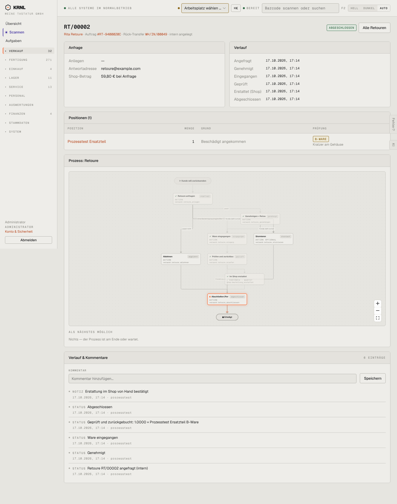

# 217-retoure-abgeschlossen — Retoure abgeschlossen

- **Bereich:** Versand & Retouren
- **Route:** `/versand/retouren/c6a68e05-c786-4cba-a9be-13ec386c3fa9`
- **Note:** 3 / 5
- **Zweck:** Abgeschlossene Retoure
- **Messwerte:** HTTP 200 · Ladezeit 853 ms · Seitenhöhe 1824 px · horizontaler Überlauf nein · Texte < 11 px: 64

## Was gut ist

- Alle Zeitpunkte vollständig
- B-Ware mit Notiz

## Befunde

| Schwere | Kategorie | Befund | Vorschlag |
|---|---|---|---|
| **mittel** | Texte | ‚Nichts — der Prozess ist am Ende oder wartet.‘ bei einer abgeschlossenen Retoure. | ‚Abgeschlossen am 17.10.2026‘. |
| **niedrig** | Funktion | Ergebnis der Fertigungsanpassung (fertigung_info) nicht sichtbar, obwohl laut Doku am Beleg gespeichert. | Zeile ‚Fertigung: keine Änderung / MO/… entfällt‘. |

[← zur Übersicht](../README.md)
