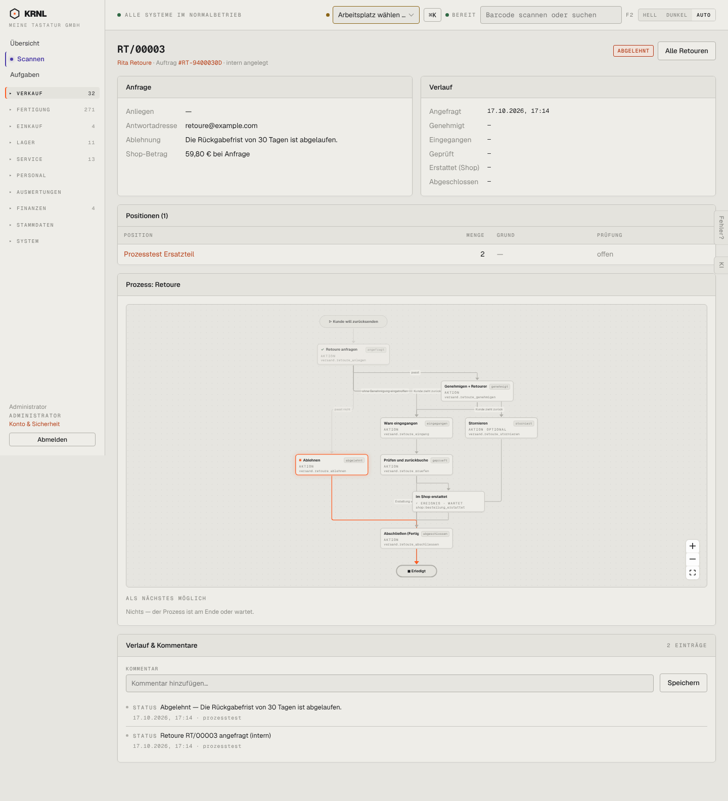

# 218-retoure-abgelehnt — Retoure abgelehnt

- **Bereich:** Versand & Retouren
- **Route:** `/versand/retouren/2d91a0d6-d9a1-48e1-87c0-e0067f325137`
- **Note:** 3 / 5
- **Zweck:** Abgelehnte Retoure
- **Messwerte:** HTTP 200 · Ladezeit 818 ms · Seitenhöhe 1583 px · horizontaler Überlauf nein · Texte < 11 px: 55

## Was gut ist

- Ablehnungsgrund sichtbar (‚Rückgabefrist von 30 Tagen abgelaufen‘)
- Status rot

## Befunde

| Schwere | Kategorie | Befund | Vorschlag |
|---|---|---|---|
| **mittel** | Schritte | Diagramm hebt den Pfad Ablehnen → Abschließen (Fertigung …) → Erledigt hervor – suggeriert, die abgelehnte Retoure sei durch ‚Abschließen‘ gelaufen. | Abgelehnt als eigener Endknoten. |
| **niedrig** | Status | Positionen zeigen ‚Prüfung: offen‘ bei abgelehnter Retoure. | ‚—‘ bzw. ‚entfällt‘. |

[← zur Übersicht](../README.md)
