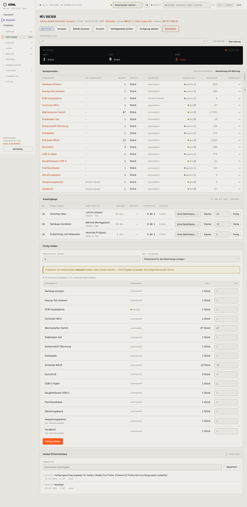

# 301-mo-bestaetigt — Fertigungsauftrag bestätigt

- **Bereich:** Fertigung
- **Route:** `/fertigung/21a0df87-9110-4861-a0d6-4addb502d37f`
- **Note:** 3 / 5
- **Zweck:** Fertigungsauftrag ausführen: Material prüfen, Arbeitsgänge, fertig melden
- **Messwerte:** HTTP 200 · Ladezeit 875 ms · Seitenhöhe 2956 px · horizontaler Überlauf nein · Texte < 11 px: 49

## Was gut ist

- Soll/Ist/Rest groß sichtbar
- Komponenten mit reserviert/verfügbar/verbraucht
- Arbeitsgänge mit Zeiterfassung und Lohnkosten
- Hinweis zur manuellen Verbrauchserfassung vor dem Fertigmelden

## Befunde

| Schwere | Kategorie | Befund | Vorschlag |
|---|---|---|---|
| **hoch** | Daten | Verfügbar-Spalte zeigt große Negativwerte (Mechanischer Switch −17.639, Schraube −1.800) ohne Erklärung – negativer verfügbarer Bestand ist für Nutzer unverständlich (gemeint: überbucht durch Reservierungen). | ‚0 verfügbar · 17.639 fehlen über alle Aufträge‘ bzw. Bedarf/Bestand getrennt; rote Hervorhebung. |
| **hoch** | Schritte | Sieben gleichrangige Knöpfe im Kopf (Drucken, Etikett drucken, Ansicht, Verfügbarkeit prüfen, Fertigung starten, Stornieren) + ‚Übernehmen‘ – der nächste Schritt (Fertigung starten) ist nicht hervorgehoben, ‚Stornieren‘ rot daneben. | Primär ‚Fertigung starten‘, Drucken als Gruppe, Stornieren ins Mehr-Menü. |
| **mittel** | Logik | Fertig melden ist möglich, obwohl 8 Komponenten ‚fehlt 0‘ (nicht reserviert) sind – kein Warnhinweis neben dem Fertig-Knopf. | Vor dem Fertigmelden Fehlteile zusammenfassen und bestätigen lassen. |
| **mittel** | Layout | Formular ‚Ist-Verbrauch anpassen‘ wiederholt alle 16 Komponenten ein zweites Mal (~900 px), standardmäßig aufgeklappt. | Ist-Werte direkt in der Komponententabelle editierbar; Abschnitt eingeklappt. |
| **niedrig** | Eingabe | Verantwortlich: volle Breite für eine Personenauswahl + Checkbox ‚Dringend‘ + ‚Übernehmen‘-Knopf. | Kompakte Zeile im Kopf (Avatar-Auswahl), Dringend als Schalter. |
| **niedrig** | Texte | Verlauf: ‚2 Position(en) aus Baugruppen aufgelöst‘. | Plural ausformulieren. |

[← zur Übersicht](../README.md)
