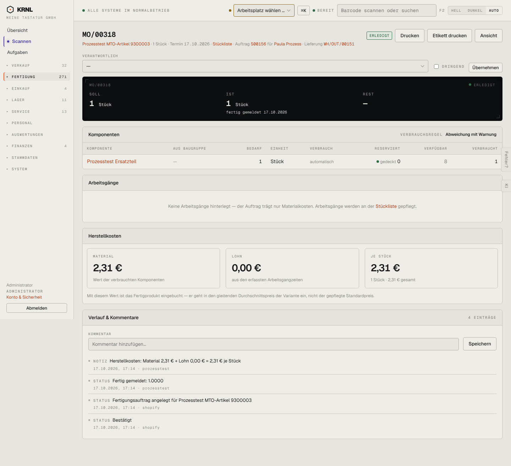

# 302-mo-fertig — Fertigungsauftrag fertig

- **Bereich:** Fertigung
- **Route:** `/fertigung/efb62574-d480-433e-a5c5-e72353938598`
- **Note:** 4 / 5
- **Zweck:** Erledigter Fertigungsauftrag mit Herstellkosten
- **Messwerte:** HTTP 200 · Ladezeit 801 ms · Seitenhöhe 1314 px · horizontaler Überlauf nein · Texte < 11 px: 42

## Was gut ist

- Herstellkosten in drei klaren Kacheln mit Erklärung
- Leerzustand Arbeitsgänge erklärt, wo sie gepflegt werden
- Kopf reduziert auf Drucken/Etikett/Ansicht

## Befunde

| Schwere | Kategorie | Befund | Vorschlag |
|---|---|---|---|
| **mittel** | Texte | Verlauf ‚Fertig gemeldet: 1.0000‘ – unformatierte Menge. | qty()-Formatierung. |
| **niedrig** | Logik | Verantwortlich/Dringend/Übernehmen bleibt bei erledigtem Auftrag editierbar. | Bei erledigt schreibgeschützt. |
| **niedrig** | Konsistenz | Schwarzer Soll/Ist-Block (Terminal-Optik) neben hellen Kostenkacheln – zwei Kennzahl-Stile auf einer Seite. | Einheitlicher Kennzahl-Stil. |

[← zur Übersicht](../README.md)
