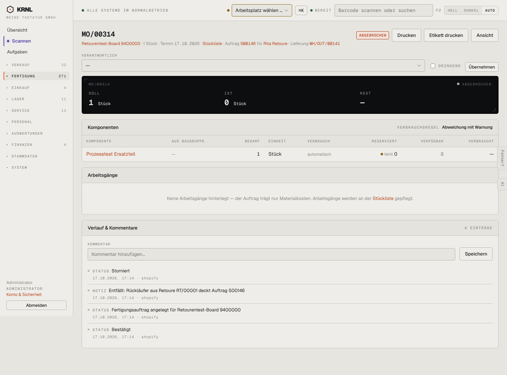

# 303-mo-storniert — Fertigungsauftrag storniert

- **Bereich:** Fertigung
- **Route:** `/fertigung/8bfed4f1-b6c4-49de-80d0-1652e52c2fdd`
- **Note:** 3 / 5
- **Zweck:** Stornierter Fertigungsauftrag (entfiel durch Rückläufer)
- **Messwerte:** HTTP 200 · Ladezeit 833 ms · Seitenhöhe 1067 px · horizontaler Überlauf nein · Texte < 11 px: 39

## Was gut ist

- Verlauf nennt Grund (‚Entfällt: Rückläufer aus Retoure RT/00001 deckt Auftrag S00146‘)

## Befunde

| Schwere | Kategorie | Befund | Vorschlag |
|---|---|---|---|
| **mittel** | Konsistenz | Status ‚ABGEBROCHEN‘ im Kopf, Verlauf sagt ‚Storniert‘ – zwei Begriffe. | Einheitlich ‚Storniert‘, bei Rückläufer ‚Entfallen (Rückläufer)‘. |
| **niedrig** | Status | Komponente zeigt ‚fehlt 0‘ (gelb) bei storniertem Auftrag – Warnfarbe ohne Bedeutung. | Reservierungsspalte bei storniert ausblenden. |
| **niedrig** | Logik | Verantwortlich/Dringend weiter editierbar; Drucken/Etikett für stornierten Auftrag angeboten. | Schreibschutz; Druck nur mit Storno-Wasserzeichen. |

[← zur Übersicht](../README.md)
