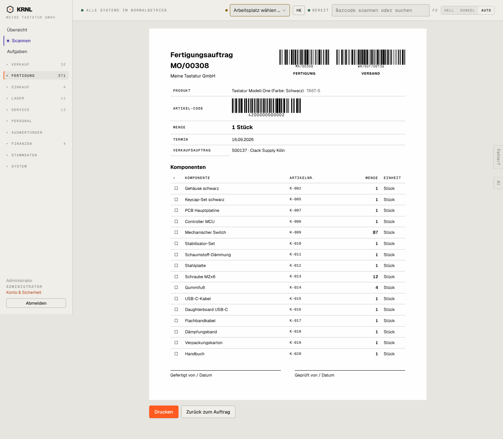

# 304-mo-druck — Fertigungszettel (Druck)

- **Bereich:** Fertigung
- **Route:** `/fertigung/21a0df87-9110-4861-a0d6-4addb502d37f/druck`
- **Note:** 4 / 5
- **Zweck:** Fertigungszettel eines Auftrags drucken
- **Messwerte:** HTTP 200 · Ladezeit 861 ms · Seitenhöhe 1258 px · horizontaler Überlauf nein · Texte < 11 px: 24

## Was gut ist

- Barcodes für Auftrag, Lieferung und Artikel
- Komponenten mit Abhak-Kästchen und Artikelnummer
- Unterschriftsfelder

## Befunde

| Schwere | Kategorie | Befund | Vorschlag |
|---|---|---|---|
| **niedrig** | Daten | Arbeitsgänge (Löten, Montieren, Prüfen) fehlen auf dem Zettel; kein Lagerplatz je Komponente. | Arbeitsgänge mit Vorgabezeit und Abhakfeld, Lagerplatz-Spalte. |
| **niedrig** | Status | Kein Hinweis auf fehlende Komponenten (8 fehlen laut Auftrag). | Fehlteile auf dem Zettel markieren. |

[← zur Übersicht](../README.md)
